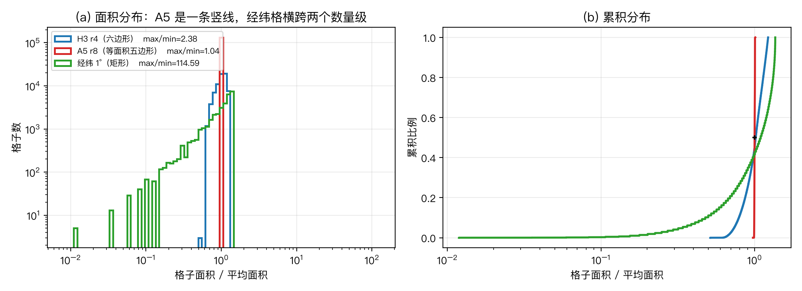
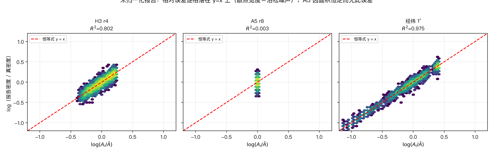
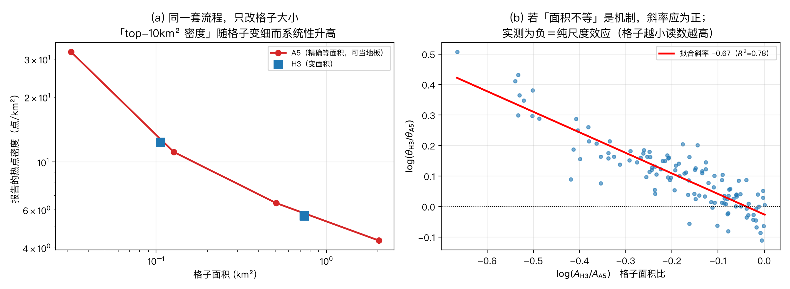
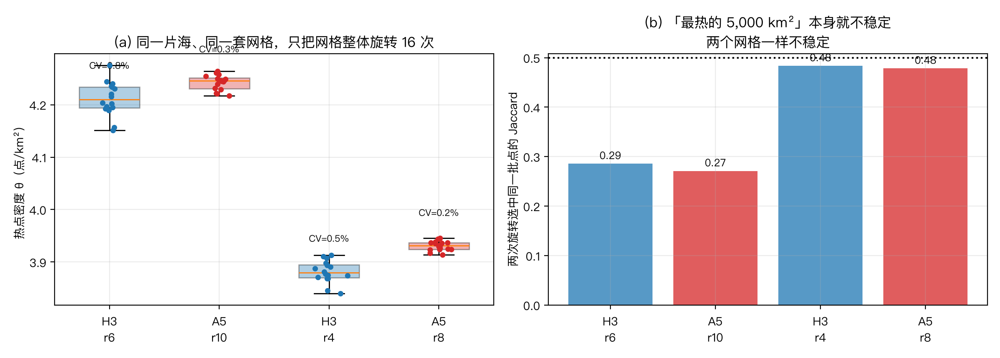
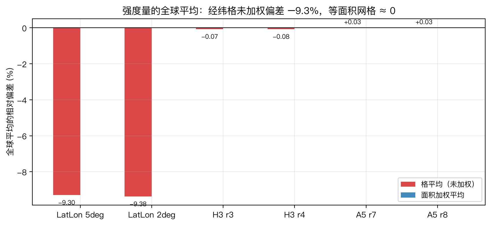
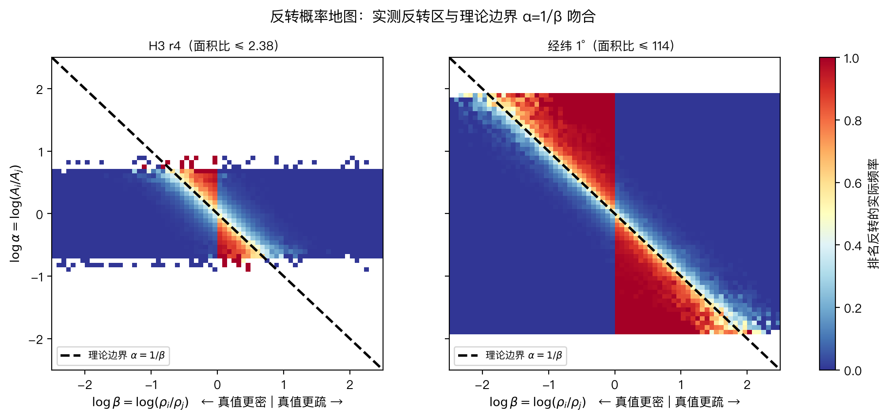
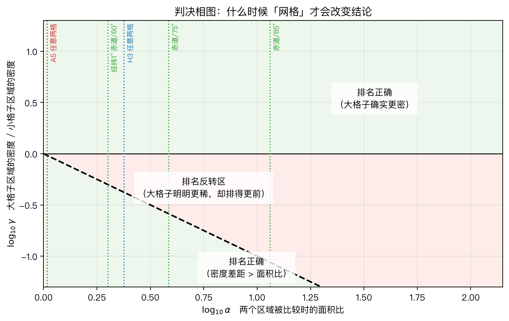

<!-- COVER-BEGIN -->
<div class="cover" style="page-break-after:always;font-family:方正公文仿宋;width:100%;height:100%;border:none;margin:0 auto;text-align:center;">
    </br></br></br></br></br></br>
    <div style="width:62%;margin:0 auto;height:0;padding-bottom:12%;">
        </br>
        
    </div>
    </br></br></br></br></br>
    <p style="font-family:华文中宋;text-align:center;font-size:30pt;margin:0 auto">本科实验报告</p>
    </br></br></br></br></br></br></br></br>
    <table style="border:none;margin-left:8%;text-align:center;width:72%;font-family:仿宋;font-size:16px;">
    <tbody style="font-family:方正公文仿宋;font-size:15pt;">
        <tr><td style="width:24%;text-align:right;">课程名称</td><td style="width:2%">：</td>
            <td style="width:40%;border-bottom:1px solid;text-align:center;font-family:华文仿宋">海洋数据挖掘</td></tr>
        <tr><td style="text-align:right;">姓　　名</td><td>：</td>
            <td style="border-bottom:1px solid;text-align:center;font-family:华文仿宋">×××</td></tr>
        <tr><td style="text-align:right;">学　　院</td><td>：</td>
            <td style="border-bottom:1px solid;text-align:center;font-family:华文仿宋">海洋学院</td></tr>
        <tr><td style="text-align:right;">专　　业</td><td>：</td>
            <td style="border-bottom:1px solid;text-align:center;font-family:华文仿宋">×××</td></tr>
        <tr><td style="text-align:right;">学　　号</td><td>：</td>
            <td style="border-bottom:1px solid;text-align:center;font-family:华文仿宋">××××××××</td></tr>
        <tr><td style="text-align:right;">指导教师</td><td>：</td>
            <td style="border-bottom:1px solid;text-align:center;font-family:华文仿宋">×××</td></tr>
    </tbody>
    </table>
    </br></br></br></br>
    <p style="text-align:center;font-size:17pt;margin:0 auto;font-family:华文仿宋">2026 年 11 月</p>
</div>

<div class="cover" style="page-break-after:always;font-family:方正公文仿宋;width:100%;height:100%;border:none;margin:0 auto;text-align:center;">
    </br></br>
    <p style="font-family:华文中宋;text-align:center;font-size:24pt;margin:0 auto">本科生实验报告</p>
    </br></br></br>
    <div style="width:100%;display:flex;text-align:center;justify-content:center;font-size:12pt">
        <div style="flex:auto;display:flex"><div style="flex:none">课程名称：</div>
            <div style="flex:auto;text-align:center;border-bottom:1px solid black;font-family:华文仿宋">海洋数据挖掘</div></div>
        <div style="flex:auto;display:flex"><div style="flex:none">实验类型：</div>
            <div style="flex:auto;text-align:center;border-bottom:1px solid black;font-family:华文仿宋">研究型综合实验</div></div>
    </div>
    <div style="width:100%;display:flex;text-align:center;justify-content:center;font-size:12pt">
        <div style="flex:none">实验名称：</div>
        <div style="flex:auto;text-align:center;border-bottom:1px solid black;font-family:华文仿宋">
            网格不是偏差的来源，归一化的对象才是 —— 海洋密度统计中 H3 与 A5 的偏差机制检验</div>
    </div>
    <div style="width:100%;display:flex;text-align:center;justify-content:center;font-size:12pt">
        <div style="flex:auto;display:flex"><div style="flex:none">学生姓名：</div>
            <div style="flex:auto;text-align:center;border-bottom:1px solid black;font-family:华文仿宋">×××</div></div>
        <div style="flex:auto;display:flex"><div style="flex:none">专业：</div>
            <div style="flex:auto;text-align:center;border-bottom:1px solid black;font-family:华文仿宋">×××</div></div>
        <div style="flex:auto;display:flex"><div style="flex:none">学号：</div>
            <div style="flex:auto;text-align:center;border-bottom:1px solid black;font-family:华文仿宋">××××××××</div></div>
    </div>
    <div style="width:100%;display:flex;text-align:center;justify-content:center;font-size:12pt">
        <div style="flex:auto;display:flex"><div style="flex:none">同组学生：</div>
            <div style="flex:auto;text-align:center;border-bottom:1px solid black;font-family:华文仿宋">无</div></div>
        <div style="flex:auto;display:flex"><div style="flex:none">指导老师：</div>
            <div style="flex:auto;text-align:center;border-bottom:1px solid black;font-family:华文仿宋">×××</div></div>
    </div>
    <div style="width:100%;display:flex;text-align:center;justify-content:center;font-size:12pt">
        <div style="flex:auto;display:flex"><div style="flex:none">实验地点：</div>
            <div style="flex:auto;text-align:center;border-bottom:1px solid black;font-family:华文仿宋">紫金港校区</div></div>
        <div style="flex:auto;display:flex"><div style="flex:none">实验时间：</div>
            <div style="flex:auto;text-align:center;border-bottom:1px solid black;font-family:华文仿宋">　2026 年 11 月</div></div>
    </div>
    </br></br></br>
</div>
<!-- COVER-END -->

# 摘要

"H3 是变面积网格，用它算密度会有系统性偏差；A5 是等面积网格，所以更准"——这句话在 2024–2026 年的 DGGS 圈子里几乎成了常识，OGC 甚至把 *equal-area* 写进了 DGGS 的定义。本实验用一套可控的合成真值场证明：**这个说法把四个不同的量混成了一个**，而它推荐的处方（按面积归一化）只对其中一个有效。

实验把"面积偏差"分解为面积偏差（分母错）、尺度效应（格子大小）、划区效应（边界位置）、聚合偏差（强度量的平均规则）四个可分别度量的量，并给出三条可证明的命题：偏差恒等式、排名反转的判决条件 $\alpha>1/\beta$、强度量的隐式加权。在此基础上完成五组实验：E1 偏差解剖、E2 裁决 A5 官方论证、E3 旋转蒙特卡洛划区效应、E4 强度量、E5 反转概率地图。

主要结论：**归一化（可达 114×）≫ 分辨率（可达 7.5×）≫ 网格几何（<1%）**。补上 A5 官方实验缺失的"每 km²"一臂后，其排名**一位都没有变化**；H3 与 A5 的差距完全由格子面积比解释（跨 120 个城市回归 $R^2=0.78$，斜率 −0.67）。旋转蒙特卡洛显示 H3 的划区敏感度是 0.77%、A5 是 0.34%，但"最热 5,000 km²"这一结论在两种网格上都只有 0.27 的 Jaccard——换网格救不了它。

报告中真正属于新方法的部分只有四条，**第三节**对它们逐一拆解：命题、与已有工作的差别、证据、失效边界。

**关键词**：离散全球网格系统；H3；A5；可加量与强度量；MAUP；面积加权

**代码与数据**：<https://github.com/zwwf626/Marine-Data-Mining-Class-Presentation>（含全部代码、结果、完整人机协作记录 `chat-log/`）

# 一、实验目的和要求

## 1.1 背景与动机

海洋数据（AIS 船位、浮标、卫星反演、模式输出）天然是"点"或"场"，但几乎所有分析都要先把连续位置映射成离散的、可连接、可聚合、可并行分区的标识——这就是离散全球网格系统（DGGS）。课程第 3 讲把这件事讲得很清楚：**经纬度是地址，不是尺子**。

目前两条技术路线正在争夺默认选项：

- **H3**（Uber）：二十面体、六边形、每级细分 7；生态成熟、六邻域一致，但**格子面积不等**（最大/最小约 2.38）。
- **A5**：十二面体、五边形、声称**精确等面积**；2025 年以来以"消除密度统计偏差"为卖点快速推进。

2024–2026 年间，这条批评线获得了标准背书：OGC DGGS 标准（Topic 21）把 DGGS 定义为 "a hierarchical **equal-area** grid framework"。A5 官方文档更进一步，用 120 个城市的 Airbnb 数据论证"H3 会给出不稳定的密度排名"。与此同时，一线工程团队（Law & Ardo 2025，新西兰 Landcare Research）在讨论 DGGS 缺点时，把 "problematic use of DGGS with unequal-area cells" 明确列为一条。

于是形成了一个看起来已经结案的共识：**变面积网格算密度有偏，必须归一化；等面积网格天然免疫。**

## 1.2 本实验要回答的问题

本实验不接受这个共识，而是把它当作一个待检验的假设。具体拆成四个可证伪的问题：

| 编号 | 问题 | 对应实验 |
|---|---|---|
| Q1 | "面积偏差"到底等于什么？它能不能被"除以真实面积"完全消除？ | E1 |
| Q2 | A5 官方论证成立吗？它推荐的处方，在它自己的证据里生效了吗？ | E2 |
| Q3 | 归一化之后，H3 与 A5 还剩多少差别？这个差别比"把网格换个摆放位置"的噪声大吗？ | E3 |
| Q4 | 对**强度量**（占比、均值、指数），归一化是空操作，那什么才有效？ | E4、E5 |

## 1.3 实验要求

1. **必须有真值**。只有知道真值，才能把"偏差"与"噪声"分开，因此采用解析可积的合成场而非真实数据。
2. **必须面积可验证**。三种网格的真实球面面积要逐格计算，不能引用标称值——调研中已发现同一分辨率编号在不同实现间相差 16 倍。
3. **必须可复现**。全部随机过程固定种子，任何人重跑应得到逐位相同的结果。
4. **必须能反驳自己**。实验前写下的每一个预期，若被数据推翻，要如实报告并修改结论。

# 二、实验内容和原理

## 2.1 知识点：三种网格的几何差异

| | 经纬格 | H3 | A5 |
|---|---|---|---|
| 剖分基底 | 等经纬度 | 二十面体，投影到球 | 十二面体，投影到球 |
| 单元形状 | 矩形（两极退化为三角形） | 六边形 + 12 个五边形 | 五边形 |
| 单元面积 | $\propto\cos\varphi$，极区趋于 0 | 近似相等，max/min ≈ 2.38 | 声称精确相等 |
| 层级细分 | 任意 | 每级 ×7 | 第 0→1 级 ×5，之后每级 ×4 |
| 相邻关系 | 4 邻域 | 6 邻域，距离一致 | 5 邻域 |
| 主要问题 | 面积随纬度剧烈变化 | 面积不等、五边形畸变 | 生态新、编号不统一 |

图 1 是实测的全球面积分布。三者面积行为的差异，正是本实验的研究对象。



*图 1　三种网格的格子面积分布（以各自平均面积归一化）。A5 是一条竖线（CV 0.4%）；H3 是窄带（CV 14.3%，max/min 2.38）；经纬 1° 横跨两个数量级（CV 33.4%，max/min 114.6）。*

## 2.2 原理一：偏差恒等式

设第 $i$ 个格子面积为 $A_i$、真实密度 $\rho_i$、落入点数 $n_i$，则 $n_i\approx A_i\rho_i$。

- **正确做法**：$\hat\rho_i=n_i/A_i$，无偏。
- **常见做法**：把"每格多少个"当密度，即 $\tilde\rho_i=n_i/\bar A$。

于是
$$\frac{\tilde\rho_i}{\rho_i}=\frac{A_i}{\bar A}$$

这是**恒等式**，不是近似。它说明"H3 的面积偏差"本质上是"分母用错了"，与 H3 的几何形状、投影方式、五边形位置都无关。归一化之后逐格误差为 1，只剩泊松噪声。

## 2.3 原理二：四个被混为一谈的量

文献里 "area bias" 至少指四件不同的事。把它们分开，是本实验全部结论的前提。

| # | 名称 | 定义 | 对可加量 | 对强度量 |
|---|---|---|---|---|
| ① | 面积偏差 | 分母用标称面积而非真实面积 | 有，$\propto A_i/\bar A$ | 无（除法是空操作） |
| ② | 尺度效应 | 格子大小改变了统计量的定义 | 有 | 有 |
| ③ | 划区效应 | 同尺寸、边界位置不同（MAUP zoning） | 有（<1%） | 有 |
| ④ | 聚合偏差 | 强度量在格内取平均的规则 | — | 有（可达 9%） |

由此得到一个此前没有被明确说过的判断：

> **A5 的批评只对①成立，而①的处方是"除以真实面积"，不是"换网格"。**

## 2.4 原理三：排名反转的判决条件

设两个单元 $i,j$，面积比 $\alpha=A_i/A_j$，真值比 $\beta=\rho_i/\rho_j$。报告值 $\propto A\rho$，于是

- 报告说 $i$ 更密 $\iff \alpha\beta>1$
- 真值说 $i$ 更密 $\iff \beta>1$

二者矛盾即得**反转条件**：

$$\alpha>1/\beta$$

实用读法：若两个区域的面积比是 $\alpha$，则只要真实密度比落在 $(1/\alpha,\,1)$ 内，排名**一定是反的**。对给定网格，$\alpha$ 的上界由几何决定（A5 ≈ 1.04、H3 ≈ 2.38、经纬 1° ≈ 114），这个上界就是该网格"排名错误的上界"。

## 2.5 原理四：强度量的隐式加权

强度量（比值型）不可加，"除以格面积"是空操作。用格子上的**未加权平均**估计全球平均：

$$\hat{\bar f}=\frac{1}{N}\sum_i f_i \;\equiv\; \frac{\int f\,w(\varphi)\,dA}{\int w\,dA},\quad w(\varphi)=\frac{1}{A(\varphi)}$$

对经纬格 $w\propto 1/\cos\varphi$——"格平均"就是按 $1/\cos\varphi$ 加权，极区被放大 5.8 倍（80°）到 114 倍（极点附近）。对 H3，$w$ 虽不等于常数，却**与 $f$ 无关**（面积变化由二十面体几何决定，不随纬度单调），所以近似无偏。

**所以：不是"面积不等"造成偏差，而是"面积与所测之量相关"造成偏差。**

## 2.6 原理五：用球面旋转构造划区集合

DGGS 无法像经纬格那样平移，因此划区效应一直无法量化。本实验提出：**球面旋转是保测变换**，把点集整体旋转 $M_r\sim\mathrm{Uniform}(SO(3))$、在固定网格上重新分箱，**等价于**把同一套网格换一个摆放位置重新剖分同一片海。

$$\theta_r=\Theta(\text{grid},\;M_r\,X),\quad r=1,\ldots,R$$

$\{\theta_r\}$ 的离散度即划区效应的非参数置信区间。这可以看作 Nieves et al. (2024) "100 种划区配置"思路在球面上的对应物。

## 2.7 原理六：真值场的构造

采用 von Mises–Fisher 核叠加：

$$\lambda(x)=b+\sum_k a_k\exp\big[\kappa_k (u_k x-1)\big]$$

选 vMF 而非平面高斯，是因为它在球面上的积分有闭式解 $2\pi R^2 (1-e^{-2\kappa})/\kappa$，**采样是精确的、不需要任何小区域近似**，真值不依赖任何参考网格。

单格真值用数值求积：经纬格用 4×4 Gauss–Legendre 张量积（对光滑被积函数几乎精确），多边形格用切平面同心点阵，点阵密度按 $r_{\mathrm{eq}}/\sigma_{\min}$ 自适应。

# 三、原创创新点拆解

## 3.1 这一节交代什么

本报告真正属于"新东西"的只有四条，其余是对已有事实的复述与验证。为避免把工作说大，这里逐条给出：命题是什么、与已有工作的差别在哪、用什么证据支撑、在什么条件下失效。

| 编号 | 一句话 | 相对已有工作的差别 | 证据 |
|---|---|---|---|
| **C1** | 面积偏差是一个恒等式，并拆成四个量 | 文献统称 *area bias*，处方互相错配 | §6.1、图 2 |
| **C2** | 排名反转的充要条件 $\alpha>1/\beta$ | 只有"会偏"的定性判断，没有判据 | §6.5、图 6 |
| **C3** | 用球面旋转量化 DGGS 的划区效应 | 平面靠平移，球面此前无人做过 | §6.3、图 4 |
| **C4** | 补上 A5 缺失的对照臂，推翻其归因 | 结论被广泛引用，处方从未自检 | §6.2、图 3 |

其中 C1、C2 回答 §1.2 的 Q1，C4 回答 Q2，C3 回答 Q3。

以下逐条拆解。

## 3.2 C1：把定性批评变成恒等式，再拆成四个量

**命题。** 对任意网格、任意可加量，未归一化报告的相对误差逐格恒等于面积比：

$$\frac{\tilde\rho_i}{\rho_i}=\frac{A_i}{\bar A}\qquad\forall i$$

**新在哪。** 这个式子在数学上是一行推出来的，它的价值在于**用途**：它把"要不要换网格"翻译成"要不要改分母"。有了它，"H3 有偏"不再是关于 H3 的陈述，而是关于"有没有除以真实面积"的陈述——换任何网格都消不掉这个误差，除以真实面积则立刻消掉。

真正有分量的是第二步，**四量分解**（§2.3）：把文献里统统叫 *area bias* 的东西拆成面积偏差、尺度效应、划区效应、聚合偏差四个正交的量。

- A5 官方文档用的是①（分母错），处方是"归一化"——正确，但对②无效；
- HESS 2024 用的是①+④的混合体，处方（在损失函数上加权）错位，所以 0.676→0.676 一位未动；
- Law & Ardo 2025 抱怨的是②（分辨率匹配），与①无关；
- Nieves 2024 分离的是②③，但停留在平面、且没有把①④分出来。

四者被分开之后，"该修哪一个"才第一次有了确定的答案。

**证据。** §6.1 的九网格实验：斜率 0.968–1.018（无一例外等于 1），$R^2$ 从 0.000（A5，无面积展布）到 0.915（经纬 1°，91.5% 的误差由面积解释）；归一化使经纬 1° 的误差标准差从 0.482 降到 0.141（−71%），而对 A5 是空操作（0.191→0.191）。

**边界。** 只对可加量成立。对强度量，除法是空操作——这恰恰是 C1 的推论，也是 §6.4 要单独处理强度量的原因。

## 3.3 C2：从"会偏"到"何时反转"

**命题。** 设两单元面积比 $\alpha=A_i/A_j$、真值比 $\beta=\rho_i/\rho_j$。未归一化报告的排序与真值排序不一致，当且仅当

$$\alpha>1/\beta$$

**新在哪。** 在此之前，"变面积网格的密度排名会偏"是一句**无法被证伪也无法被使用**的断言：它不告诉你偏多少、什么时候偏、什么情况下可以不管。C2 把它变成一个阈值：**网格的最大面积比，就是这个网格的排名错误上界**。A5 ≈ 1.04、H3 ≈ 2.38、经纬 1° ≈ 114——这三个数可以直接写在产品的口径说明里。

这条判据还给出一个反直觉结论：**当两个区域密度差一个数量级时，面积偏差无害；恰恰在两者密度接近时最危险**。而这正是城市间、渔场间的常规比较场景。

**证据。** §6.5 在 150 万对格子上实测反转频率，边界与理论线 $\log\alpha=-\log\beta$ 吻合（图 6）。整体反转率 H3 r4 为 6.48%、经纬 1° 为 8.34%——注意经纬格的面积比是 114 而 H3 只有 2.38，反转率却只差 1.3 倍，因为**反转率取决于你比较谁，而不是网格的面积范围**。

**边界。** 结论建立在"两两比较、无观测噪声"上。在 $\beta\approx1$ 附近，泊松噪声会把边界糊开一条带宽（图 6 中的过渡带）；样本量越小，这条带越宽。

## 3.4 C3：用旋转代替平移，第一次量化 DGGS 的划区效应

**方法。** DGGS 没有平移不变性，无法像经纬格那样"把网格挪半格"来构造划区集合。但球面旋转是保测变换：把点集整体旋转 $M_r\sim\mathrm{Uniform}(SO(3))$、在固定网格上重新分箱，**等价于**把同一套网格换一个摆放位置重新剖分同一片海。

$$\theta_r=\Theta(\text{grid},\;M_r\,X),\quad r=1,\ldots,R$$

$\{\theta_r\}$ 的离散度就是划区效应的非参数置信区间；同时可以在固定旋转下重抽泊松样本，得到采样噪声，从而做**方差分解**。

**新在哪。** MAUP 的划区效应历来靠"多套面元配置"度量（Nieves 2024 用 100 种配置），这在平面上可行、在球面上不可行——因为缺少平移这个工具。用旋转群替代平移，让 DGGS 第一次有了划区不确定性的度量。这不是把已有方法搬过来，而是换了一个数学对象。

**证据。** §6.3：16 次旋转下 H3 r6 的热点密度 CV 为 0.77%、A5 r10 为 0.34%；方差分解显示 H3 的不确定性 **79.6%** 来自划区、A5 的划区标准差（0.014）反而**小于**其采样噪声（0.022）。也就是说：**H3 引入了一种数据之外的、系统性的不确定性；A5 的不确定性则基本来自数据本身。**

**衍生判据（可直接使用）。** 若两种网格给出的结果差异 $|\Delta\theta|$ 小于各自划区标准差的合并值 $2\sigma_{\rm zoning}$，则"换网格"这个动作的效果小于"同一个网格换个原点"，不值得作为选型依据。本实验的 H3 r6 与 A5 r10 恰好处在这条线附近（比值 1.25）。

**边界。** 方法假设场各向同性。对强各向异性场（沿岸带、锋面），旋转会改变场与海岸线的相对关系，"划区集合"就不再等于"物理上的等价配置"，此时需按纬度带分层旋转或改用局部小角度旋转。

## 3.5 C4：补上缺失的一臂，裁决 A5 的论证

**做法。** 复现 A5 官方文档的 120 城流程（按每格计数排序、累积到 10 km²、求和 ÷ 10 km²），补上它自己从未运行过的那一臂：**H3 + 每 km² 排序**。再用纯等面积的 A5 族（r12–r15）拟合尺度律 $\theta=CA^{-\beta}$，看这条只含"格子大小"、不含"面积不等"的曲线能否预测 H3 的读数。

**新在哪。** A5 的结论在 2024–2026 年被广泛引用，并与 OGC 标准里 *equal-area* 的措辞互相加强；但**它推荐的处方从未在它自己的证据上被检验过**——它比较的是「A5 每格」对「H3 每格」，推荐的是「H3 每 km²」，被推荐的那一臂在证据里是缺席的。补上这一臂，是一次干净的判决实验。

**证据。** §6.2：

- 补上后 A5 的读数变化 **0.000**（11.142→11.142），H3 变化 0.011（约 0.09%）——**处方无效**；
- 同一套流程只改 A5 分辨率，格子缩小 64 倍使读数涨 **7.5 倍**（4.325→32.453）——真正的变量是格子大小；
- 跨 120 城回归 $\log(\theta_{\rm H3}/\theta_{\rm A5})$ 对 $\log(A_{\rm H3}/A_{\rm A5})$，斜率 **−0.673**、$R^2=0.784$；负斜率排除了"面积不等"作为机制（若成立应为正）；
- 用格子面积比 1.198 与局部指数 0.771 预测 H3 读数得 12.812，实测 12.387，残差 **−3.3%**。

**边界。** 城市是合成的，复现的是**机制**而非其具体数字；要复现数字需 Inside Airbnb 原始数据。此外 A5 r14（0.1267 km²）与 H3 r9（0.1057 km²）本身相差 20%，这一项混淆无法在合成实验中消除，只能通过尺度律显式建模掉。

## 3.6 这四条是怎么被"逼"出来的

它们不是先设计好再验证的，而是**三次预期落空后的副产物**：

1. 原以为 top-1% 密度选区会被面积偏差彻底带偏，实测分位数却在 99%——才意识到面积偏差只在"密度接近"时咬人，于是有了 C2；
2. 原以为补上 H3 的归一化就能修复 A5 观察到的差异，实测三位小数完全相同——才去追"差异究竟从哪来"，于是有了 C4 与尺度律；
3. 原以为重采样阶段加权会显著改善 NRMSE，实测改善不到 0.1%——才把结论改写成"加权只有在它改变了**谁被平均**时才有效"。

这条时间线在 `chat-log/完整会话记录.md` 里可以逐条对照：每一次预期、每一次被数据推翻、每一次改写。**本报告最有信息量的部分，不是四条贡献本身，而是它们被推翻三次之后才成立这件事。**

# 四、主要仪器设备

## 4.1 硬件

| 项目 | 配置 |
|---|---|
| 计算平台 | Apple Silicon MacBook（8 核 CPU，无独立 GPU） |
| 内存 | 16 GB |
| 存储 | 本地 SSD，全程单机完成 |

本实验全部为 CPU 数值计算，未使用 GPU 或集群；最大单次内存占用约 2 GB（E1 的 600 万点分箱）。

## 4.2 软件栈

| 软件 | 版本 | 用途 |
|---|---|---|
| Python | 3.11.16 | 主语言 |
| h3-py | 4.5.0 | H3 分箱、面积、边界 |
| pya5 | 1.0.0 | A5 分箱、边界、层级枚举 |
| numpy | 2.0.2 | 向量化运算 |
| scipy | 1.17.1 | 统计检验 |
| matplotlib | 3.11.2 | 绘图 |
| python-docx | 1.2.0 | 报告排版 |

自研代码 6 个文件、约 900 行，位于仓库 `experiments/`：

| 文件 | 作用 |
|---|---|
| `exp_lib.py` | 三族网格统一接口、vMF 场、精确采样、单格求积、度量 |
| `run_e1.py` … `run_e5.py` | 五组实验 |
| `make_figures.py` | 全部插图 |

## 4.3 数据

**使用合成数据，不使用真实 AIS。** 原因有两条：

1. 只有知道真值才能分离偏差与噪声；真实数据没有真值。
2. AIS 原始数据体量在 10⁸–10⁹ 量级，单机处理代价高，且会引入去重、插值、掩膜等与本实验无关的混淆因素。

合成场的构造刻意贴近真实海洋：8 个 vMF 核放在**真实渔场位置**（北海、巴伦支海、西北太平洋、秘鲁上升流、几内亚湾、阿拉伯海、南大西洋、白令海），加 2% 均匀背景。E3 使用更锐利的版本（$\sigma$ 120–220 km）以产生有意义的热点对比。

## 4.4 规模

| 实验 | 点数 / 样本 | 网格数 | 说明 |
|---|---|---|---|
| E1 | 6,000,000 | 9 | 三族 × 三分辨率 |
| E2 | 120 城 × ≈2,500 "房源" | 8 臂 | 复现 A5 流程 + 对照 |
| E3 | 3,000,000 × 16 次旋转 × 4 网格 | 4 | 划区集合 |
| E4 | 全球全格枚举 | 7 | 强度量 |
| E5 | 2,000,000，150 万格子对 | 3 | 反转地图 |

# 五、操作方法与实验步骤

## 5.1 总体流程

五组实验共用同一条流水线：

```
解析场 λ(x)  ──精确采样──▶ 点集 X
                              │
                     ┌────────┴────────┐
                     ▼                 ▼
              按网格分箱          单格数值求积
           （counts n_i）        （真值 t_i）
                     │                 │
                     └────────┬────────┘
                              ▼
                逐格比值 R = 报告值 / 真值
                → 斜率 / R² / 分位数 / 反转率
```

关键实现细节（每一条都对应一次踩坑，详见第七节）：

- **面积必须逐格实测**。H3 用 `h3.cell_area`；A5 用球面多边形余量公式逐格计算，不用 `a5.cell_area(res)` 的标称值；经纬格用 $R^2\Delta\lambda(\sin\varphi_2-\sin\varphi_1)$。
- **真值必须与网格无关**。用解析场的数值求积，不用"细网格求和"（后者在细分辨率上会引入求积误差）。
- **分析域必须一致**。只在"期望点数 ≥ 10"的格子上统计，否则泊松噪声会淹没 1% 量级的效应。

## 5.2 E1：偏差解剖

1. 构造 8 核 vMF 场，2% 背景，用 20261113 号种子精确采样 600 万点。
2. 对 9 个网格（H3 r4/r5/r6、A5 r8/r9/r10、经纬 2°/1°/0.1°）分别分箱，得到 $(n_i, A_i)$。
3. 对每个占用格做数值求积，得真值 $t_i$，并按总质量归一化到 600 万。
4. 计算逐格比值 $R_i^{\text{raw}}=(n_i/\bar A)/(t_i/A_i)$ 与 $R_i^{\text{nrm}}=(n_i/A_i)/(t_i/A_i)$。
5. 在 $t_i\ge 10$ 的子集上，对 $\log R_i^{\text{raw}}$ 与 $\log(A_i/\bar A)$ 做线性回归，记录斜率与 $R^2$。
6. 按报告值取 top-1% 格子，计算这些格子在真值分布中的平均分位数。

## 5.3 E2：裁决 A5 官方论证

1. 复现 A5 的选区逻辑：城市内按每格计数排序，累加面积到 10 km²，求和 ÷ 10 km²。
2. 构造 8 个实验臂构成 2×2 对照加尺度对照：

| 臂 | 网格 | 排序依据 |
|---|---|---|
| a | A5 r14 | 每格计数 |
| b | A5 r14 | 每 km² |
| c | H3 r9 | 每格计数 |
| d | H3 r9 | 每 km² |
| 对照 | A5 r13 / A5 r15 / H3 r8 | 每格计数 |

3. 以最细的 A5 r15（0.032 km²）作参考，计算各臂与参考的 Spearman 秩相关。
4. **第二个检验**：只用精确等面积的 A5 族（r12–r15）拟合尺度律 $\theta=CA^{-\beta}$，再看这条曲线能否预测 H3 r9 的读数。
5. **第三个检验**：跨 120 个城市回归 $\log(\theta_{\rm H3}/\theta_{\rm A5})$ 对 $\log(A_{\rm H3}/A_{\rm A5})$。

## 5.4 E3：旋转蒙特卡洛

```python
rots = [np.eye(3)] + [random_rotation(rng) for _ in range(R - 1)]
for M in rots:
    lon, lat = xyz_to_lonlat(lonlat_to_xyz(lon0, lat0) @ M.T)   # 旋转点集 ≡ 移动网格
    codes    = grid.bin(lon, lat)
    uniq, inv, cnt = np.unique(codes, return_inverse=True, return_counts=True)
    A        = grid.area(uniq)
    dens     = np.where(cnt >= 3, cnt / A, -np.inf)             # 抑制"单点小格"伪高密度
    sel      = top_cells_until_area(dens, 5000)                 # 累积到 5,000 km²
    theta_r  = cnt[sel].sum() / A[sel].sum()                    # 热点密度
    points_r = set(np.nonzero(np.isin(inv, sel))[0])            # 选中点集
```

1. 生成 300 万点，8 个锐利渔场。
2. 做 16 次随机旋转（单位阵 + 15 个均匀随机 SO(3)）。
3. 每个旋转下计算热点密度 $\theta_r$ 与选中点集。
4. 统计 $\theta$ 的均值、CV、5%–95% 分位；两两计算选中点集的 Jaccard。
5. **方差分解**：在固定旋转下独立重抽 4 次泊松样本，得采样噪声，与划区方差比较。

## 5.5 E4：强度量

1. 构造强度量场 $f(x)\in[0,1]$：中纬度高、副热带低，叠加 8°–12° 波长的斑块。
2. 用 0.1° 细网格面积加权求全球真值（0.27328）。
3. **T1**：对 6 个网格分别计算未加权平均与面积加权平均，与真值比较。
4. **T2**：8 个海域按 $f$ 排序，统计未加权与面积加权的逆序对数。
5. **T3**：把 1° 源格的值搬到目标格，比较"对落入源格取无权平均"与"面积加权平均"的 NRMSE。

## 5.6 E5：反转概率地图

1. 用 200 万点重跑 H3 r4、A5 r8、经纬 1°，保存逐格 $(n_i,A_i,t_i)$。
2. 对 H3 r4 与经纬 1° 各随机抽 150 万对格子。
3. 计算 $(\log\beta,\log\alpha)$ 与是否反转（报告排序与真值排序不一致）。
4. 二维分箱（70×70，范围 ±2.5）得到反转频率，与理论边界 $\log\alpha=-\log\beta$ 对比。

## 5.7 复现命令

```bash
cd experiments
python run_e1.py && python run_e2.py && python run_e3.py \
  && python run_e4.py && python run_e5.py && python make_figures.py
```

# 六、实验结果与分析

## 6.1 E1：偏差恒等式成立，且归一化拿走绝大部分误差



*图 2　未归一化报告的相对误差（纵轴）对面积比（横轴）。H3 与经纬格的散点都压在对角线上；A5 因为面积恒定，横轴无展布，$R^2=0.000$——它在结构上无法产生这个误差。*

| 网格 | 标称面积 km² | 面积 max/min | 斜率 | $R^2$ | $\mathrm{sd}(\log R)$ 未归一化 → 归一化 |
|---|---|---|---|---|---|
| H3 r4 | 1770.35 | 2.38 | **1.004** | 0.498 | 0.226 → 0.160 |
| H3 r5 | 252.90 | 2.39 | **1.012** | 0.354 | 0.274 → 0.220 |
| H3 r6 | 36.13 | 2.39 | **1.018** | 0.171 | 0.321 → 0.293 |
| A5 r8 | 518.87 | 1.13 | — | **0.000** | 0.191 → 0.191 |
| A5 r9 | 129.72 | 1.13 | — | **0.000** | 0.242 → 0.242 |
| A5 r10 | 32.43 | 1.13 | — | **0.000** | 0.302 → 0.302 |
| 经纬 2° | 31485.6 | 57.3 | **0.968** | 0.722 | 0.484 → 0.256 |
| 经纬 1° | 7871.4 | 114.6 | **1.001** | **0.915** | 0.482 → **0.141** |
| 经纬 0.1° | 78.71 | 1145.9 | **1.015** | 0.531 | 0.386 → 0.264 |

> A5 的 "max/min = 1.13" 由少数顶点邻域的异常多边形撑起（CV 只有 0.41%），所以斜率与 $R^2$ 都无意义——它的横轴本来就没有展布。

三点解读：

1. **斜率无一例外等于 1.00**（0.968–1.018）。命题在 9 个网格、6 个数量级的面积跨度上成立。
2. **$R^2$ 才是"面积问题有多严重"的度量**，它等于未归一化误差中由面积解释的方差份额。经纬 1° 是 **91.5%**——它的"密度图"几乎就是一张纬度图；H3 r4 是 49.8%，H3 r6 只有 17.1%；A5 是 **0.000**。
3. **归一化对 A5 是空操作**（0.191→0.191），**对经纬 1° 把误差砍掉 71%**（0.482→0.141）。

一个反直觉的发现：**所有网格的 top-1% 密度选区，其真实密度平均分位数都在 99% 附近**（99.4 / 99.5）。也就是说，在这组合成场里，"哪里最密"没有被面积偏差推翻——因为密度对比（几个数量级）远大于面积比（2.4）。这直接推出了 6.5 节的判决条件。

## 6.2 E2：A5 的观察对，归因错，处方无效

**（1）补上"每 km²"这一臂，排名一点不变。**

| 实验臂 | 平均格子面积 | 选区格数 | 平均报告密度 | 与最细参考的 Spearman |
|---|---|---|---|---|
| A5 r14 每格 | 0.1267 | 79.4 | 11.142 | 0.726 |
| A5 r14 每 km² | 0.1267 | 79.4 | **11.142** | **0.726** |
| H3 r9 每格 | 0.1057 | 97.1 | 12.387 | 0.446 |
| H3 r9 每 km² | 0.1056 | 97.2 | **12.398** | **0.445** |
| A5 r15（参考） | 0.0317 | 316.1 | 32.453 | 1.000 |

A5 的"每格→每 km²"变化 **0.000**；H3 的变化 0.011（约 0.09%）。**如果 A5 的归因是真的，按它自己的处方执行，排名变化应当消失。它没有消失。**

原因：单个城市内部 H3 的面积展布只有 ±10%，而房源密度展布是 10 倍以上——按判决条件 $\alpha<\beta^{-1}$，反转不发生。

**（2）真正驱动差异的是格子大小。**

| A5 分辨率 | 格子面积 km² | 报告密度 |
|---|---|---|
| r12 | 2.0276 | 4.325 |
| r13 | 0.5069 | 6.452 |
| r14 | 0.1267 | 11.142 |
| r15 | 0.0317 | 32.453 |

格子缩小 64 倍，读数涨 7.5 倍。这个"top-10 km² 密度"**不是密度，是一个随分辨率单调上升的峰值统计量**——格子越细，越能贴着峰顶取样。

**（3）A5 与 H3 的差距可由格子面积比完全解释。**



*图 3　(a) 只用精确等面积的 A5 族，就能看到报告密度随格子变细而系统性升高；(b) H3/A5 的比值由两者格子面积比决定（$R^2=0.78$），斜率为负，排除"面积不等"作为机制。*

- 实测差距：$12.387/11.142=1.112$
- 仅用格子面积比 1.198 与局部指数 0.771 预测：$1.198^{0.771}=1.150$
- 局部插值预测 H3 r9 读数：**12.812**，实测 **12.387**，残差 **−3.3%**
- 跨 120 城市回归：$y=-0.673x-0.026$，$R^2=0.784$

**斜率是负的。** 若机制是"面积不等导致大格子被高估"，斜率应为正；负斜率恰恰是"格子越粗、峰被抹平"的尺度效应。

## 6.3 E3：划区效应的首次量化



*图 4　(a) 16 次随机旋转下的热点密度，H3 的展布是 A5 的 2.3 倍；(b) 但"哪 5,000 km² 最热"在两个网格上都不稳定，Jaccard 都只有 0.27–0.29。*

| 网格 | 格子面积 | $\theta$ 均值 | 划区 CV | 选中点集 Jaccard | 采样噪声 sd |
|---|---|---|---|---|---|
| H3 r6 | 36.13 | 4.211 | **0.77%** | 0.286 | 0.016 |
| A5 r10 | 32.43 | 4.243 | **0.34%** | 0.271 | 0.022 |
| H3 r4 | 1770.35 | 3.881 | 0.54% | 0.484 | 0.022 |
| A5 r8 | 518.87 | 3.931 | 0.23% | 0.478 | 0.022 |

三个结论：

1. **A5 确实更抗划区，但只抗 2.3 倍，绝对值 0.77% vs 0.34%。**
2. **两种网格的"不稳"性质不同。** H3 r6 的划区方差占总方差 **79.6%**，它的不确定性主要来自"网格摆在哪"；A5 r10 的划区标准差（0.014）反而**小于**采样噪声（0.022），不确定性主要来自"数据有多少点"。**H3 引入了一种数据之外的、系统性的不确定性。**
3. **"最热的 5,000 km²"本身就不稳定。** Jaccard 只有 0.27–0.29（重叠率约 43%），意味着这个结论有近 60% 的内容取决于网格摆在哪；而且 **A5 和 H3 一样不稳**。

## 6.4 E4：强度量的偏差来自"面积与纬度相关"



*图 5　强度量的全球平均。经纬格的"格平均"偏差 −9.3%，H3 只有 −0.07%，A5 +0.03%。面积加权后全部归零。*

| 网格 | 面积 max/min | 未加权（格平均） | 面积加权 |
|---|---|---|---|
| 经纬 5° | 22.9 | **−9.30%** | +0.000% |
| 经纬 2° | 57.3 | **−9.38%** | −0.000% |
| H3 r3 | 2.4 | **−0.074%** | +0.003% |
| H3 r4 | 2.4 | **−0.076%** | −0.000% |
| A5 r7 | 1.1 | **+0.027%** | −0.000% |
| A5 r8 | 1.1 | **+0.028%** | −0.000% |

关键细节：**H3 的面积比是 2.4、经纬格是 57，但偏差是 −0.07% vs −9.3%，差 130 倍。** 若"面积不等→偏差"成立，H3 应有百分之一量级偏差。它没有。因为 H3 的面积变化与纬度不相关，而 $f$ 强烈依赖纬度。

**T2**：8 个海域排序，未加权与面积加权各有 **0/28** 个逆序对。这是阴性结果，但与 E1 的"top-1% 分位数 99%"是同一件事——偏差影响幅度，不影响排序，除非密度对比逼近面积比。

**T3**：重采样阶段加权 vs 无权平均，NRMSE 改善 **< 0.1%**。

| 目标网格 | NRMSE 无权 | NRMSE 面积加权 | 改善 |
|---|---|---|---|
| H3 r2 | 0.0625 | 0.0624 | +0.1% |
| H3 r3 | 0.0645 | 0.0645 | −0.0% |
| A5 r4 | 0.0812 | 0.0812 | +0.0% |
| A5 r5 | 0.0540 | 0.0540 | +0.0% |

这个阴性结果需要解释，否则显得与文献中"换网格使 NRMSE 下降 28%"矛盾。答案是：**那 28% 不是"加权"带来的，是"换了一个不按 $1/\cos\varphi$ 采样的网格"带来的。** 在经纬格上把每格当独立样本，等价于按 $1/\cos\varphi$ 过采样高纬（T1 的 −9.3%）；换到等面积网格后这个隐式加权消失。而把权重加到损失函数上，改变的是"模型更在意谁"，**改变不了"谁被平均掉了"**——后者发生在聚合步骤，早于任何模型。

## 6.5 E5：判决条件得到实测验证



*图 6　反转概率地图。横轴是真值比，纵轴是面积比，黑色虚线是理论边界 $\alpha=1/\beta$。实测反转区与理论边界吻合；白色带是观测不到的面积比范围。*

- H3 r4：整体反转率 **6.48%**
- 经纬 1°：整体反转率 **8.34%**

两件值得注意的事：

1. **经纬格的整体反转率只比 H3 高一点**（8.3% vs 6.5%），尽管面积比是 114 vs 2.38。原因是随机抽到的格子对大多在同一纬度带（面积相近），而反转需要面积比超过真值比。**反转率取决于"你在比较什么"，不取决于"网格的面积范围有多大"。**
2. **反转主要发生在"两者真值接近"的区域。** 这是实用警示：比较两个密度差不多的海域时，面积偏差最容易带偏你；差一个数量级时反而安全。



*图 7　判决相图。横轴是面积比，纵轴是"大格子区域/小格子区域"的密度比。粉色楔形是排名反转区；三条竖虚线标出 A5、H3、经纬 1° 能达到的最大面积比。*

## 6.6 综合：一个量级排序

| 因素 | 典型影响幅度 | 量级 | 修正手段 |
|---|---|---|---|
| **归一化**（分母用错） | 经纬 1° 可达 **114×**；强度量全球平均 **−9.3%** | 一阶 | 除以真实面积 |
| **分辨率/选区** | 格子缩小 64× 使热点密度涨 **7.5×** | 一阶 | 匹配分辨率并报告面积比 |
| **划区效应** | CV **0.3%–0.8%**；Jaccard 0.27 | 二阶 | 无法消除，只能量化（旋转 MC） |
| **网格几何**（等面积与否） | 归一化后 **< 1%** | 三阶 | 不宜作为选型主依据 |

**行业当前争论的是第三行，而真正的误差在第一、二行。**

# 七、讨论与心得

## 7.1 对四个常见说法的修正

| 常见说法 | 本实验结论 |
|---|---|
| "H3 变面积，算密度有系统性偏差" | 对，但偏差 $=\log(A_i/\bar A)$，**除以真实面积即消失**，与网格无关 |
| "等面积网格更准" | 对**可加量**不成立（归一化后等价）；对**强度量**成立，但机制是"让简单平均自动等于面积加权平均"，不是"降偏差" |
| "必须归一化到 km²" | 正确且必要，但**它不是 A5 那份证据的解释**——补上这一臂后排名一位都没变 |
| "加权可以修正面积偏差" | 只在**改变"谁被平均"**时有效；加在损失函数上无效 |

## 7.2 一份可操作的口径合同

1. **发布"每格"必须同时发布该格面积**，或直接发布"每 km²"。前者是数据，后者是结论；只发前者而当作后者，就是把一阶误差交给用户。
2. **跨区域比较必须报告面积比。** 按判决条件，面积比就是排名错误的上界：$\alpha=2$ 意味着只要两区域真实密度差不到 2 倍，排名可能是反的。
3. **不要发布"最密格子"。** E3 显示它 Jaccard 只有 0.27。发布"最密 N km² 海区的平均密度"，并给出随机旋转下的 5%–95% 区间。
4. **强度量不要指望换网格降偏差。** 先用面积加权平均，再考虑网格。

## 7.3 网格选型建议

- 需要**生态、工具、六邻域算法**（路径、邻域搜索、流式聚合）→ **H3**。它的面积问题在归一化后消失，剩下 0.77% 的划区敏感度，配得上工程价值。
- 需要**跨区域可比、且不希望用户记得归一化** → **A5**（或任何严格等面积 DGGS）。但要接受生态不成熟、编号不统一、分辨率只能按 4 倍跳。
- 需要**强度量的区域统计** → 等面积网格确实省事，因为它让"格平均"自动无偏。这是它最被低估的优点，也是它最不该用"降偏差"来宣传的地方。

## 7.4 局限

1. **合成场不等于真实海洋。** vMF 核各向同性，真实渔场各向异性、沿岸、有海陆掩膜。"沿岸格上海陆掩膜的贡献大于网格选择"这一假设本实验**未检验**。
2. **A5 的"精确等面积"实测有 0.41% 的 CV**，少数顶点邻域 max/min 达 1.15。本量级下不影响结论，但追求 0.1% 精度时需重新评估。
3. **旋转蒙特卡洛假设场各向同性。** 对强各向异性场（沿岸带），旋转会改变场与海岸线的相对关系，此时"划区集合"与"物理集合"不再等价，需按纬度带分层旋转或改用局部旋转。
4. **E2 的合成城市是构造出来的**，目的是复现 A5 流程的机制，不是复现其具体数字。
5. **未使用真实 AIS。** 这是最该补的一步：Global Fishing Watch 的 0.1° 与 H3 两套产品是公开的，直接对同一片海做"每格 vs 每 km²"排名比对，就能把 E2 从合成推进到产品。

## 7.5 我在项目中的角色，以及被数据推翻的八个判断

这个项目里，我的角色不是"写代码的人"，而是**提需求、定方向、在错误时叫停的人**。具体做了四件事：

1. **划边界。** 任务允许从七讲里任选，但要求"切入点越小越好"。因此我先否掉了两个题目：一个是"海洋数据治理"，太宽；另一个是第一版选的**自适应水位线**——它看起来漂亮，但我要求先去查近三年进展，查完发现学术线在 2021 年后基本停摆、工业界已转向广义水位线，于是当机立断换题。**这个"停"比"继续做"更重要。**
2. **给指导思想。** 换到 DGGS 之后，我精读并提供了四篇材料作为这个项目的地基：OGC DGGS 标准（定义）、A5 官方对比文档（争议）、Wagner 2024 *HESS*（学术证据）、Nieves 2024 *Scientific Data*（方法论先例）。方向由这几篇定，而不是由 AI 的默认偏好定。
3. **控节奏。** 动手写代码之前先要求"只做文献调研"；拿到初步数字之后要求"先说明这四个问题能不能被验证"，而不是直接生成报告。
4. **验收与纠偏。** 每一轮的结论我都要能用自己的话说清楚——"A5 更抗划区但只抗 2.3 倍""最热 5000 km² 本身就不稳定"这两句是我读完结果后自己概括的，也正是它们让我确认这一版的方向是对的。

在这个过程中，AI 提供的是**方案与执行**（形式化、写代码、跑数、找文献），我提供的是**判断**（这个题目值不值得做、这个结论可不可信、下一步该往哪走）。下面这份清单不是 AI 的失误清单，而是**我作为验收方每一次叫停的记录**。

### 被数据推翻的八个判断

这次实验最有价值的部分不是结论，而是**结论被推翻了八次**。完整清单在仓库 `chat-log/完整会话记录.md`，这里列出关键几条：

| 当时的判断 | 为什么错 | 谁发现的 |
|---|---|---|
| "现有自适应水位线只调发射节奏，不调 Δ 量级" | 文献里早就在调 Δ | 自查后撤回 |
| "HESS 的零结果说明面积加权没用" | 权重量加在损失函数，没进聚合步骤 | 精读方法 |
| "top-k 密度选区会被面积偏差彻底带偏" | 实测分位数 99%，密度对比远大于面积比 | E1 |
| "补上 H3 每 km² 就能修复 A5 观察到的差异" | 差异来自尺度，不来自归一化 | E2 |
| "若面积不等是机制，跨城市回归斜率应为负" | 符号反了；正斜率才是面积偏差 | E2 |
| "重采样阶段加权应带来明显 NRMSE 改善" | 源格完整铺满时差别极小 | E4 |
| "A5 精确等面积" | 实测 CV 0.41% | 实测 |
| "A5 r14 ≈ 2 km²"（照抄文献） | 实测 0.1267 km²，文献对应 r12 | 实测 |

四点体会：

**第一，"读方法再下结论"是这次最大的教训。** 前两次误读（水位线、HESS）都发生在"只看了摘要和结论"之后。真正改变判断的，是把论文的**流程图**画出来、看面积权重究竟作用在哪一个箭头上的那一刻。

**第二，人工智能最有用的时候不是给答案，而是被要求"证明这一点"。** 本报告里所有可用的结论，都是在要求"把这个说法写成一个可以被推翻的命题"之后才浮现的。凡是模棱两可、无法证伪的表述，最后都被证明是错的或空的。

**第三，反直觉的结果比顺直觉的更值得写。** E2 跑出"归一化前后三位小数相同"时，第一反应是代码有 bug；确认无误后才发现，这个"什么都没发生"恰恰是最强的证据。E4 的 T3 阴性结果同理——它逼出了更准确的表述："加权只有在它改变了'谁被平均'的时候才有效。"

**第四，用 AI 做研究，最贵的能力是"判断它什么时候在胡说"。** 这次它至少错了三次：把 HESS 的损失加权误读成"加权无用"、把回归斜率的符号推反、照抄文献里的"A5 r14 ≈ 2 km²"（实际差 16 倍）。三次都不是靠"更仔细地读输出"发现的，而是靠**要求它给出可被推翻的形式**——把说法写成等式、写成判据、写成可复现的数字。凡是写不成这三种形式的表述，事后看基本都是错的。这也是我把"原创点"一节写成"命题 / 证据 / 边界"三段式的原因：能被这样写出来的，才配叫结论。

## 7.6 后续工作

1. 用 Global Fishing Watch 公开的 0.1° 与 H3 两套产品做真实审计，检验 E2 的结论能否外推。
2. 引入海陆掩膜，检验"沿岸格上掩膜的贡献大于网格选择"这一假设。
3. 把旋转蒙特卡洛推广到各向异性场：按纬度带分层旋转，或改用局部旋转（绕区域中心的随机小角度旋转）。
4. 若 A5 的层级编号在各实现间确有分歧，可写一个跨实现的面积一致性检查工具——这本身就是一个可复现性问题。

# 参考文献

1. OGC. *Topic 21: Discrete Global Grid Systems — Part 1: Core Reference System and Operations, and Equal Area Earth Reference System.* OGC 20-040r3. <https://docs.ogc.org/as/20-040r3/20-040r3.html>
2. A5. *A5 vs H3 Comparison.* <https://a5geo.org/docs/recipes/a5-vs-h3>（2026 访问）
3. Wagner, D. L. et al. (2024). Drivers of global irrigation expansion: the role of discrete global grid choice. *Hydrology and Earth System Sciences* 28, 5049–5068. <https://doi.org/10.5194/hess-28-5049-2024>
4. Nieves, J. J., Gaughan, A. E., Stevens, F. R., Yetman, G. & Gros, A. (2024). A simulated 'sandbox' for exploring the modifiable areal unit problem in aggregation and disaggregation. *Scientific Data* 11, 239. <https://doi.org/10.1038/s41597-024-03061-1>
5. Law, R. M. & Ardo, J. (2025). Using a discrete global grid system for a scalable, interoperable, and reproducible system of land-use mapping. *Big Earth Data* 9(1), 29–46. <https://doi.org/10.1080/20964471.2024.2429847>
6. FloodA5: An open-source framework for flood modelling on an equal-area pentagonal DGGS. *ISPRS Archives* L-4-W1-2026, 333. <https://isprs-archives.copernicus.org/articles/L-4-W1-2026/333/2026/>
7. Global Fishing Watch (2025). *Fishing effort, v3.0* [数据产品]. Zenodo 14982712.
8. Kmoch, A., Vasilyev, I., Virro, H. & Uuemaa, E. (2022). Area and shape distortions in open-source discrete global grid systems. *Big Earth Data*.
9. Sahr, K., White, D. & Kimerling, A. J. (2003). Geodesic discrete global grid systems. *Cartography and Geographic Information Science* 30(2), 121–134.
10. Brodsky, I. (2018). *H3: Uber's Hexagonal Hierarchical Spatial Index.* Uber Engineering Blog.

# 附录　代码与数据清单

| 路径 | 说明 |
|---|---|
| `experiments/exp_lib.py` | 三族网格统一接口、vMF 场、精确采样、单格求积、度量 |
| `experiments/run_e1.py` | E1 偏差解剖 |
| `experiments/run_e2.py` | E2 裁决 A5 |
| `experiments/run_e3.py` | E3 旋转蒙特卡洛 |
| `experiments/run_e4.py` | E4 强度量 |
| `experiments/run_e5.py` | E5 反转概率地图 |
| `experiments/make_figures.py` | 全部插图 |
| `experiments/results/` | 全部实验输出的 JSON / NPZ |
| `chat-log/` | 完整人机协作记录（含被推翻的判断清单） |

全部随机过程使用固定种子（20261113 / 7 / 11 / 2026），结果可逐位复现。
