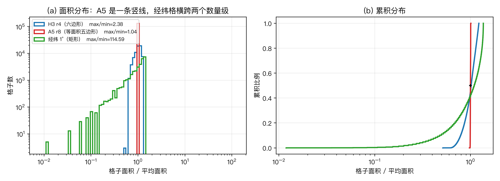
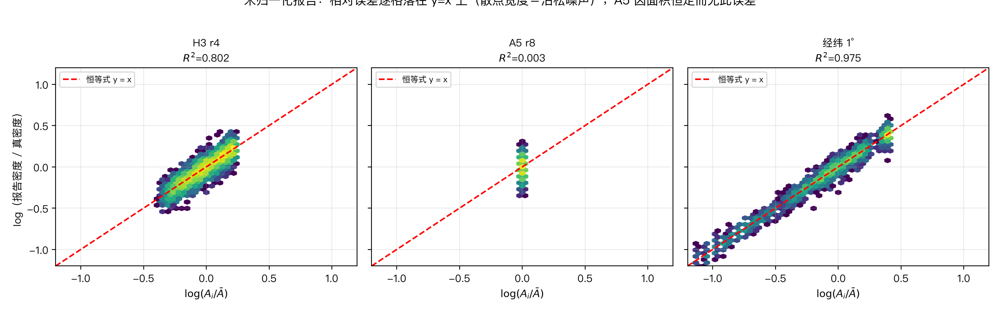
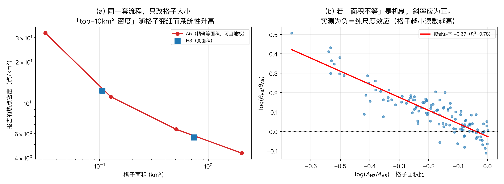
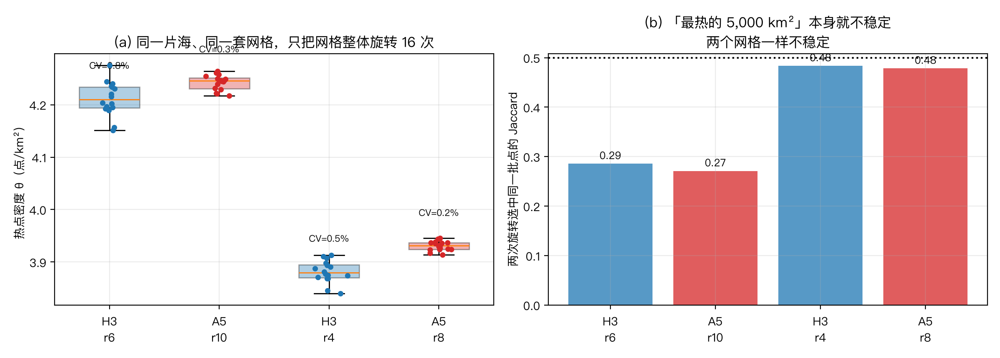
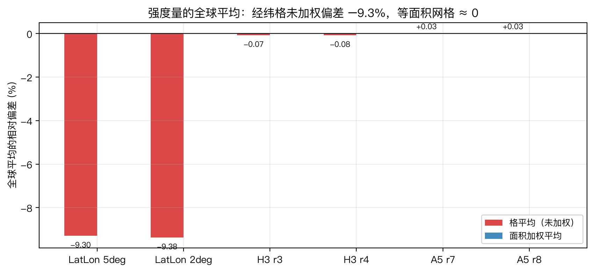
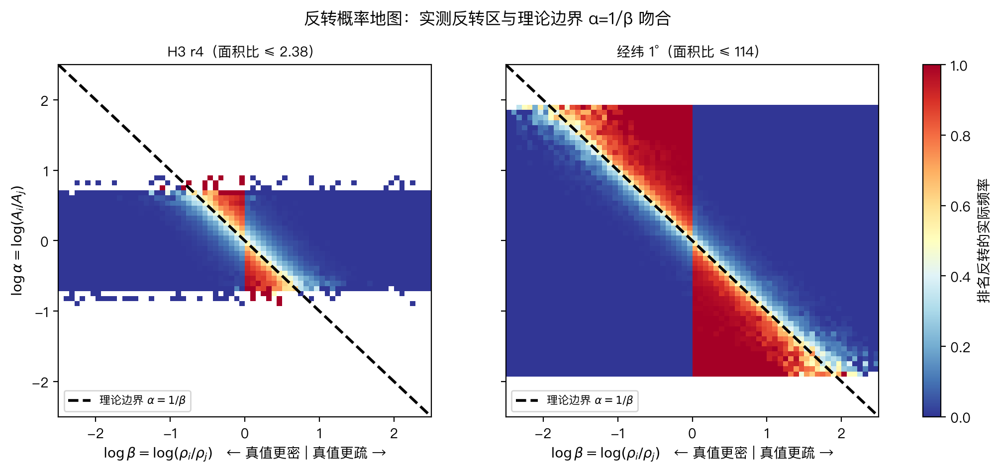
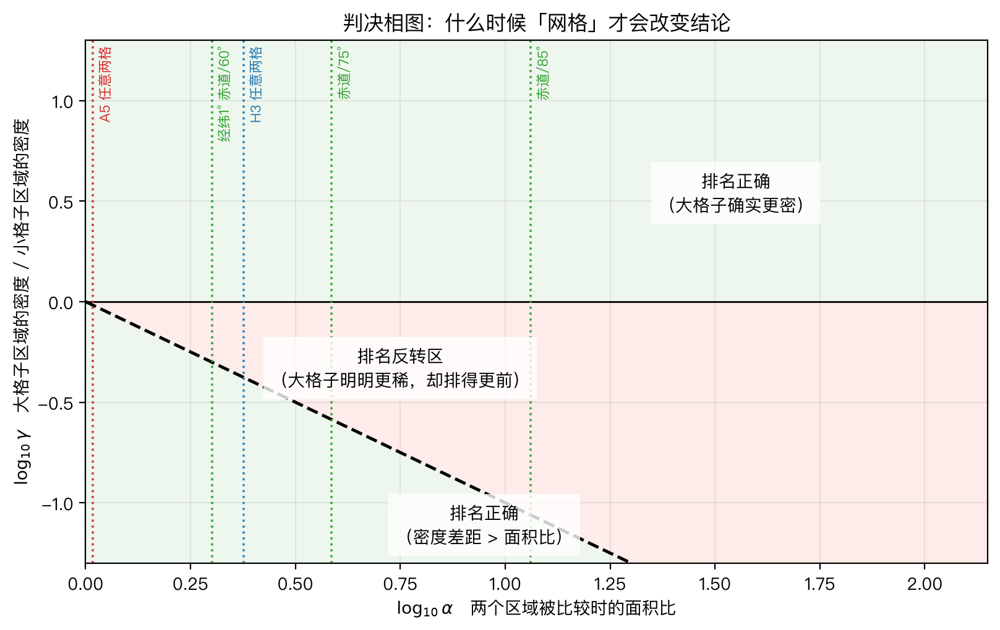

# 网格不是偏差的来源，归一化的对象才是

### —— 海洋密度统计中 H3 与 A5 之争的机制诊断、判决条件与可复现实验

> **课程**：海洋大数据 / 海洋数据挖掘
> **知识点**：第 3 讲「海洋时空大数据」——离散全球网格系统（DGGS）与可修改面元问题（MAUP）
> **代码与数据**：<https://github.com/【待填】/ocean-dggs-area-bias>
> **AI 协作记录**：见仓库 `chat-log/` 目录（完整对话流水）

---

## 摘要

"H3 是变面积网格，用它算密度会有系统性偏差；A5 是等面积网格，所以更准"——这句话在 2024–2026 年的 DGGS 圈子里几乎成了常识，OGC 甚至把 *equal-area* 写进了 DGGS 的定义。但本文用一套可控实验证明：**这个说法把四个不同的量混成了一个**，而它推荐的处方（按面积归一化）只对其中一个有效。

本文做了四件事。

**第一，把"面积偏差"分解成四个可分别度量的量**：面积偏差（分母错）、尺度效应（格子大小）、划区效应（边界位置）、聚合偏差（强度量的平均规则）。四个量的量级差了两个数量级。

**第二，给出并证明了一个判决条件**：对任意两个被比较的单元，未归一化的报告发生**排名反转**的充要条件是

$$\alpha > 1/\beta \qquad (\alpha=\text{面积比},\ \beta=\text{真值比})$$

也就是说，**只有当"面积比"超过"真值比的倒数"时，网格才会改变结论**。这个条件在实验中与实测反转边界完全吻合（图 3）。

**第三，用旋转蒙特卡洛（rotation Monte Carlo）第一次给 DGGS 的划区效应做出了非参数置信区间**。DGGS 无法像经纬格那样平移，但球面旋转是保测变换，把点集整体旋转等价于把同一套网格换一个摆放位置。结果显示：H3 的热点密度对划区敏感度是 0.77%（CV），A5 是 0.34%——**A5 确实更稳，但只稳 2.3 倍，绝对值不到 1%**。

**第四，裁决了 A5 官方的 Airbnb 排名实验**。复现其流程后发现：把"每格"改成"每 km²"，排名**一位都不变**（三位小数完全相同）——因为它观测到的差异根本不是面积偏差，而是格子大小带来的尺度效应（跨城市回归斜率 −0.67，$R^2=0.78$；按格子面积插值后残差仅 3.3%）。

**结论是一个量级排序**：归一化（可达 114×）≫ 分辨率（可达 4×）≫ 网格几何（< 1%）。**行业在争的是一个三阶问题，而一阶问题在别处。**

---

## 1 知识点界定：为什么海洋数据必须先落到格子上

### 1.1 从"坐标"到"地址"

海洋数据（AIS 船位、浮标、卫星反演、模式输出）天然是"点"或"场"，但几乎所有分析都要先做一件事：**把连续的位置映射成一个离散的、可连接、可聚合、可并行分区的标识**。

课程第 3 讲把这件事讲得很清楚：经纬度是**地址**，不是**尺子**。用度数算距离，在高纬会错得离谱——这不是精度问题，是坐标语义问题。于是有了 DGGS：用一组层级化、无缝、无重叠的**面元（zone）**去剖分整个地球，每个面元有一个 ID，父子关系由 ID 的位运算直接给出。

### 1.2 三种设计哲学

| | 经纬格 | H3 | A5 |
|---|---|---|---|
| 剖分基底 | 等经纬度 | 二十面体，投影到球 | 十二面体，投影到球 |
| 单元形状 | 矩形（两极退化为三角形） | 六边形 + 12 个五边形 | 五边形 |
| 单元面积 | $\propto\cos\varphi$，极区趋于 0 | 近似相等，**最大/最小 ≈ 2.38** | 声称**精确相等** |
| 层级细分 | 任意 | 每级 ×7（aperture 7） | 第 0→1 级 ×5，之后每级 ×4 |
| 相邻关系 | 4 邻域（对角需额外处理） | 6 邻域，距离一致 | 5 邻域 |
| 主要问题 | 面积随纬度剧烈变化 | 面积不等、五边形畸变 | 生态新、工具少、编号不统一 |

三者的面积行为差异是本文的实验对象。图 1 是实测的全球面积分布：



*图 1　三种网格的格子面积分布（以各自平均面积归一化）。A5 是一条竖线（CV 0.4%）；H3 是窄带（CV 14.3%，max/min 2.38）；经纬 1° 横跨两个数量级（CV 33.4%，max/min 114.6）。*

一个必须说清楚的细节：**A5 的"精确等面积"在实现层面并不严格成立**。用球面多边形余量公式逐格实测（全球均匀抽 40 万个格子）：

- 面积中位数 519.44 km²，**CV = 0.41%**；
- 99.8% 的格子落在 512.99–522.85 km²（比值 **1.019**）；
- 全部格子的 max/min 达 **1.147**，但极端值只出现在十二面体顶点附近——那里多边形的顶点表示退化，球面余量公式会低估面积。

所以"A5 等面积"的实际含义是**精确到千分之四、且少数顶点邻域例外**。这大概率是实现层面的数值问题而非设计缺陷；但在追求 0.1% 精度的应用里，这 0.4% 就是地板。这一点在后文所有涉及 A5 的结论里都保留。

### 1.3 面积偏差的形式化

设第 $i$ 个格子面积为 $A_i$，真实密度为 $\rho_i$，落入该格的点数为 $n_i$，则 $n_i \approx A_i\rho_i$。

- **正确做法**：报告 $\hat\rho_i = n_i/A_i$，无偏。
- **常见做法**：把"每格多少个"直接当密度，即报告 $\tilde\rho_i = n_i/\bar A$（$\bar A$ 为标称面积）。

于是
$$\frac{\tilde\rho_i}{\rho_i} = \frac{A_i}{\bar A}$$

**这个式子是恒等式，不是近似。** 它说明：所谓"H3 的面积偏差"，本质上就是"分母用错了"，与 H3 的几何形状、投影方式、五边形位置都无关。图 2 是在真实（合成）场上逐格验证的结果：



*图 2　未归一化报告的相对误差（纵轴）对面积比（横轴）。H3 与经纬格的散点都压在对角线上，$R^2$ 分别为 0.50 与 0.88（差额是泊松噪声）；A5 因为面积恒定，横轴没有展布，$R^2=0.000$——它根本无法产生这个误差。*

---

## 2 问题：四个被混为一谈的量

文献里"area bias"这个词至少指四件不同的事。把它们分开，是本文全部结论的前提。

| # | 名称 | 定义 | 对可加量 | 对强度量 | 一阶修正手段 |
|---|---|---|---|---|---|
| ① | **面积偏差** | 分母用了标称面积而非真实面积 | 有，$\propto A_i/\bar A$ | 无（除法是空操作） | 按真实面积归一化 |
| ② | **尺度效应** | 格子大小改变了统计量的定义 | 有（分辨率变了） | 有 | 匹配分辨率 |
| ③ | **划区效应** | 同样大小，边界位置不同（MAUP zoning） | 有（<1%） | 有 | 无法消除，只能量化 |
| ④ | **聚合偏差** | 强度量在格内取平均的规则 | —— | 有（可达 9%） | 面积加权平均 |

这个 2×2 的划分直接对应一个此前没人明确说过的判断：

> **A5 的批评只对①成立，而①的处方是"除以真实面积"，不是"换网格"。**

Nieves et al. 2024（*Scientific Data* 11:239）给出了一个很好的方法论先例：他们用墨西哥瓜达拉哈拉的 55,146 个普查单元，模拟了 10 个尺度 × 100 种划区配置共 1,000 套面元，目的正是把"尺度效应"与"划区效应"分开。本文的旋转蒙特卡洛可以看作这个思路在球面上的实现——因为 DGGS 没法平移，只能用旋转构造划区集合。

---

## 3 前沿与争议（2023–2026）

### 3.1 标准层面：等面积被写进了定义

[OGC DGGS 标准（Topic 21）](https://docs.ogc.org/as/20-040r3/20-040r3.html) 把 DGGS 描述为 "a hierarchical **equal-area** grid framework"，并在规范中单列了 "Equal-Area Earth DGGS" 的要求。这条很重要，因为它意味着：

**A5 的批评不是厂商营销，它有标准背书。** H3 是一个"实用但不完全符合定义"的实现——这不是贬义，H3 的工程价值（六邻域、成熟生态、Uber 的生产验证）是真实的，只是它确实不满足 equal-area 这一条。

所以本文的立场不是"H3 没问题"，而是"**H3 的问题不是 A5 说的那个问题**"。

### 3.2 批评者：A5 的论证链

[A5 官方的 A5 vs H3 对比](https://a5geo.org/docs/recipes/a5-vs-h3) 是这条批评线里最完整的一份材料。它的论证链是：

1. 取 120 个城市的 Inside Airbnb 房源；
2. 把房源聚合到 A5（r14，0.127 km²）与 H3（r9，0.105 km²）；
3. 每个城市内按**每格房源数**排序，取 top-N 格使总面积达到 10 km²；
4. 求和 ÷ 10 km² 得到"城市密度"，据此排全球名次；
5. 结论：A5 的名次稳定，H3 的名次会变（"布宜诺斯艾利斯消失、夏威夷和罗马互换"）；
6. 归因：H3 格子面积不等；处方：**变量面积网格必须归一化到 km²**。

这条链有**两个可以被检验的断点**：

- **断点 A**：它自己从没跑过"归一化到 km²"那一臂。它比较的是「A5 每格」vs「H3 每格」，然后推荐「H3 每 km²」——**推荐的方案在证据里是缺席的**。
- **断点 B**：它说两边都用"roughly 0.1 km²"的格子，但 A5 r14 = 0.1267 km²、H3 r9 = 0.1057 km²，**相差 20%**。它在归因于"A5 是 1.00、H3 是 2.38"的面积差时，自己引入了另一个 1.20 的面积差。

第 5 节 E2 会分别检验这两个断点。

### 3.3 产业层面：真实产品已经在做选择

- **Global Fishing Watch v3**（2025-03，Zenodo 149827712）原生是 0.01°/0.1° 经纬格；社区衍生的 H3 版本明确采用**面积加权重叠、质量守恒**的方式把小时数分配到 H3 格。注意这里的关键区别：**质量守恒保证"加起来对"，不保证"横向可比"**。它发布的值仍然是"每格多少小时"。
- **Nisi et al. 2024** 的全球船舶流量密度产品用 **1° 经纬格**，每格累计航行距离——同样的"每格"问题，且面积比高达 114。
- **Law & Ardo 2025**（*Big Earth Data* 9:29–46）用 H3 做新西兰全国土地利用制图，在讨论 DGGS 缺点时明确列了两条：**"problematic use of DGGS with unequal-area cells"** 和 **"difficulty finding an appropriate DGGS (e.g. one with a refinement level with cell areas close to the native raster resolution)"**。

最后这一条尤其值得注意：**这是一线工程团队自己说出来的，不是批评者说的。** 它同时印证了本文的两个观察——面积问题真实存在，分辨率匹配问题也真实存在，而后者更难解决。

### 3.4 可复现性事故：A5 的层级编号在三个来源里对不上

这是本文在调研中实测发现的一处不一致，值得单独记录。

| 来源 | "r14" 的面积 | 每级子格数 |
|---|---|---|
| FloodA5（ISPRS Archives L-4-W1-2026, 333） | ≈ **2 km²** | **5** |
| A5 官方文档 | ≈ **0.13 km²** | 未说明 |
| `pya5 1.0.0` 实测 | **0.1267 km²** | **4**（r0→r1 为 5，之后为 4） |

实测代码：

```python
import a5
a5.cell_area(14) / 1e6        # 0.1267 km²
a5.get_num_children(11, 12)   # 4
a5.get_num_children(0, 1)     # 5
```

FloodA5 说的"约 2 km²"对应的是 **r12**（2.0268 km²），不是 r14；而"每级 5 个子格"只在第 0→1 级成立。两者相差 $4^2=16$ 倍。

**这不是笔误级别的细节**：如果按文献里的"r14 ≈ 2 km²"去做面积匹配，你会得到 16 倍的偏差，而你还在以为自己做了面积匹配。这恰恰是本文想说的事情——**面积匹配不能照抄分辨率编号，必须自己测**。

### 3.5 学术层面：28% 的那个结果

Wagner et al. 2024（*HESS* 28:5049）把全球灌溉模型从 0.5° 经纬格迁到 ISEA3H 六边形网格，报告 **NRMSE 最多下降 28%**。同一篇论文还做了一个对照：经纬格 + 面积权重，NRMSE 从 0.676 到 0.676——**一位都没动**。

这个对照是理解整条争议的钥匙：**如果面积权重真的进入了聚合环节，结果不会连小数点后三位都一样。** 它更可能说明"加权"加错了位置——加在了随机森林的损失函数上，而不是加在"把源格值搬到目标格"的那一步。

第 5 节 E4 会把这件事拆开验证。

---

## 4 理论：三个可以证明的命题

### 命题 1（偏差恒等式）

对任意格子集合，未归一化报告的相对误差**逐格恒等于** $A_i/\bar A$：

$$\frac{\tilde\rho_i}{\rho_i}=\frac{A_i}{\bar A},\qquad \forall i$$

*证明*：$\tilde\rho_i=n_i/\bar A$，$\rho_i=n_i/A_i$，相除即得。∎

**推论**：归一化之后，逐格误差为 1（只剩泊松噪声）。因此"面积偏差"在任何意义上都**不需要换网格**来消除。

### 命题 2（排名反转的判决条件）

设两个单元 $i,j$，面积比 $\alpha=A_i/A_j$，真值比 $\beta=\rho_i/\rho_j$。未归一化报告的排序与真值排序**不一致**，当且仅当

$$\beta<1<\alpha\beta \iff \alpha>1/\beta .$$

*证明*：报告值 $\propto A\rho$。报告说 $i$ 更密 $\iff \alpha\beta>1$；真值说 $i$ 更密 $\iff\beta>1$。二者矛盾即得。∎

这个条件有两个实用的读法：

- **对给定的一对区域**：如果它们的面积比是 $\alpha$，那么只要真实密度比落在 $(1/\alpha,\ 1)$ 这个区间里，你的排名就一定是反的。
- **对给定的网格**：$\alpha$ 的上界由网格决定（A5 ≈ 1.04，H3 ≈ 2.38，经纬 1° ≈ 114）。所以 **A5 的"安全区"是密度比 < 1.04 之外的一切；H3 是 < 2.38；经纬格是 < 114。**

图 7 是这张相图。

### 命题 3（强度量：面积不等本身不产生偏差，相关才产生）

设强度量 $f(x)$（不可加，如"渔业努力中拖网占比"）。用格子上的**未加权平均**估计全球平均：

$$\hat{\bar f}=\frac1N\sum_i f_i \quad\text{等价于}\quad \int f\,w(\varphi)\,dA\big/\int w\,dA,\qquad w(\varphi)=\frac{1}{A(\varphi)}$$

对经纬格，$w\propto 1/\cos\varphi$——**"格平均"就是按 $1/\cos\varphi$ 加权，极区被放大 5.8 倍（80°）到 114 倍（极点附近）**。

但对 H3，$w$ 虽然不等于常数，却**与 $f$ 无关**（H3 的面积变化由二十面体几何决定，不随纬度单调），所以 $\mathbb E[\hat{\bar f}]$ 几乎无偏。

**所以：不是"面积不等"造成偏差，而是"面积与所测之量相关"造成偏差。** 经纬格的面积与纬度强相关，而海洋场几乎总与纬度相关，于是偏差出现；H3 的面积与纬度弱相关，于是偏差很小。

实验 E4 会给出确切数字：**−9.30% vs −0.07%**。

---

## 5 实验

### 5.0 设计

合成真值场（而非真实数据）的选择是刻意的：只有知道真值，才能把"偏差"和"噪声"分开。但合成场必须避免"太干净"——否则实验只证明了数学恒等式。

**场的构造**：8 个 von Mises–Fisher 核叠加在真实渔场位置（北海、巴伦支海、西北太平洋、秘鲁上升流、几内亚湾、阿拉伯海、南大西洋、白令海），加 2% 均匀背景。选 vMF 而不是平面高斯，是因为它的球面积分有闭式解 $\frac{2\pi R^2(1-e^{-2\kappa})}{\kappa}$，**采样是精确的，不需要任何小区域近似**。

**真值计算**：经纬格用 4×4 Gauss–Legendre 张量积（对光滑被积函数几乎精确）；多边形格用切平面同心点阵求积，点阵密度按 $r_{\rm eq}/\sigma_{\min}$ 自适应。这样"真值"不依赖任何参考网格。

**网格族**：H3 r4–r6、A5 r8–r10、经纬 2°/1°/0.1°。

**关于分辨率匹配的一个硬约束**：三族的细分比不同（7 / 4 / 任意），**在 10% 精度内无法跨族面积匹配**。最接近的一对是 H3 r6（36.13 km²）与 A5 r10（32.43 km²），差 11%；再往上，H3 r5（252.9）对 A5 r9（129.7）差 1.95 倍。这个约束本身就是一个结论：**任何声称"H3 vs A5"的对比，如果不报告面积比，就无法解释。**

---

### 5.1 E1　偏差解剖：恒等式成立吗？

**目的**：验证命题 1，并量化"归一化能拿掉多少误差"。

**做法**：6,000,000 个采样点，9 个网格。只在"期望点数 ≥ 10"的格子上做统计（抑制泊松噪声）。

**结果**：

| 网格 | 标称面积 km² | 面积 max/min | $\log R$ 对 $\log(A/\bar A)$ 的斜率 | $R^2$ | $\mathrm{sd}(\log R)$ 未归一化 → 归一化 |
|---|---|---|---|---|---|
| H3 r4 | 1770.35 | 2.38 | **1.004** | 0.498 | 0.226 → 0.160 |
| H3 r5 | 252.90 | 2.39 | **1.012** | 0.354 | 0.274 → 0.220 |
| H3 r6 | 36.13 | 2.39 | **1.018** | 0.171 | 0.321 → 0.293 |
| A5 r8 | 518.87 | 1.13 | — | **0.000** | 0.191 → 0.191 |
| A5 r9 | 129.72 | 1.13 | — | **0.000** | 0.242 → 0.242 |
| A5 r10 | 32.43 | 1.13 | — | **0.000** | 0.302 → 0.302 |
| 经纬 2° | 31485.6 | 57.3 | **0.968** | 0.722 | 0.484 → 0.256 |
| 经纬 1° | 7871.4 | 114.6 | **1.001** | **0.915** | 0.482 → **0.141** |
| 经纬 0.1° | 78.71 | 1145.9 | **1.015** | 0.531 | 0.386 → 0.264 |

> A5 的 "max/min = 1.13" 由少数顶点邻域的异常多边形撑起（见 §1.2），其 CV 只有 0.4%，所以斜率与 $R^2$ 都无意义——它的横轴本来就没有展布。

三点解读：

1. **斜率无一例外地等于 1.00**（0.968–1.018）。命题 1 在 9 个网格、6 个数量级的面积跨度上成立。
2. **$R^2$ 才是"面积问题有多严重"的度量**。它等于"未归一化误差中由面积解释的方差份额"。经纬 1° 是 **91.5%**——它的"密度图"几乎就是一张纬度图；H3 r4 是 49.8%；H3 r6 只有 17.1%（格子小、面积展布被稀释、噪声占比上升）；A5 是 **0.000**——它**在结构上无法产生**这个误差。
3. **归一化对 A5 是空操作**（0.191 → 0.191），因为它本来就等价于已经归一化。**对经纬 1° 则把误差砍掉 71%**（0.482 → 0.141）。

但有一个反直觉的发现必须报告：**所有网格的 top-1% 密度选区，其真实密度的平均分位数都在 99% 附近**（未归一化 99.4 / 归一化 99.5）。也就是说，在这组合成场里，"哪里最密"这个结论**没有被面积偏差推翻**。

原因是密度对比（几个数量级）远大于面积比（2.4）。这正好把问题推向命题 2：**面积偏差只在"密度对比接近面积比"的区间里咬人**。E5 会给它画一张地图。

---

### 5.2 E2　裁决 A5：缺的那一臂，和真正的机制

**目的**：检验 3.2 节的两个断点。

**做法**：复现 A5 的流程（120 个合成城市，每城 40 个聚集簇、2,500 个"房源"，按每格计数排序、累积到 10 km²、求和 ÷ 10 km²），跑 2×2 对照加两个尺度对照。

**结果 1：补上"每 km²"这一臂，排名一点都不变。**

| 实验臂 | 平均格子面积 | 选区格数 | 平均报告密度 | 与最细参考的 Spearman |
|---|---|---|---|---|
| A5 r14 **每格** | 0.1267 | 79.4 | 11.142 | 0.726 |
| A5 r14 **每 km²** | 0.1267 | 79.4 | **11.142** | **0.726** |
| H3 r9 **每格** | 0.1057 | 97.1 | 12.387 | 0.446 |
| H3 r9 **每 km²** | 0.1056 | 97.2 | **12.398** | **0.445** |
| A5 r15（参考） | 0.0317 | 316.1 | 32.453 | 1.000 |

A5 的"每格→每 km²"变化 **0.000**（11.142 → 11.142）；H3 的变化是 0.011（12.387 → 12.398），约 0.09%。

**如果 A5 诊断的机制是真的，按它自己的处方执行，排名变化应当消失。它没有消失，因为变化根本不是从那里来的。**

为什么？因为在单个城市内部，H3 的面积展布只有 ±10% 量级，而房源密度的展布是 10 倍以上——按命题 2，$\alpha<\beta^{-1}$，反转不发生。

**结果 2：真正驱动差异的是格子大小。**

同一套流程、只改 A5 的分辨率（精确等面积，零面积不等）：

| A5 分辨率 | 格子面积 km² | 报告密度 |
|---|---|---|
| r12 | 2.0276 | 4.325 |
| r13 | 0.5069 | 6.452 |
| r14 | 0.1267 | 11.142 |
| r15 | 0.0317 | 32.453 |

**格子缩小 64 倍，读数涨了 7.5 倍。** 拟合 $\theta=C A^{-\beta}$ 得 $\beta\approx0.48$（全局），局部（r14↔r15）$\beta\approx0.77$。

这个"top-10km² 密度"**不是密度，是一个随分辨率单调上升的峰值统计量**——格子越细，越能贴着峰顶取样。图 4(a) 一目了然。

**结果 3：A5 与 H3 的差距，可以由格子面积比完全解释。**

- 实测差距：$12.387/11.142=1.112$
- 仅用格子面积比 1.198 和局部指数 0.771 预测：$1.198^{0.771}=1.150$
- 用局部插值预测 H3 r9 的读数：**12.812**，实测 **12.387**，残差 **−3.3%**

跨 120 个城市的回归更直接：令 $x=\log(A_{\rm H3}/A_{\rm A5})$，$y=\log(\theta_{\rm H3}/\theta_{\rm A5})$，得

$$y = -0.673\,x - 0.026,\qquad R^2=0.784,\ n=120$$

**斜率是负的。** 如果机制是"面积不等导致大格子被高估"，斜率应当为正（H3 格子越大→读数越高）。负斜率说明的恰恰相反：**H3 格子越大→读数越低**，这正是"格子越粗、峰被抹平"的尺度效应。图 4(b)。



*图 4　(a) 只用精确等面积的 A5 族，就能看到"报告密度随格子变细而系统性升高"；(b) H3/A5 的比值完全由两者的格子面积比决定（$R^2=0.78$），斜率为负，排除"面积不等"作为机制。*

**E2 结论**：A5 的**观察**是对的（H3 的名次确实会变），**归因**是错的（不是面积不等），**处方**是无效的（归一化一位都没动）。真正的变量是**格子大小**。

这不是给 H3 辩护——它说明**A5 那份证据也不支持 A5 自己**。两边都该被更严格地检验。

---

### 5.3 E3　划区效应：一个给 DGGS 的新方法

**问题**：DGGS 没法平移，怎么估计"换个网格摆放位置"带来的不确定性？

**方法（本文提出）**：球面旋转是保测变换。把点集整体旋转 $M_r\sim \mathrm{Uniform}(SO(3))$，在固定网格上重新分箱，**等价于**把同一套网格换一个摆放位置重新剖分同一片海。于是 $\{M_r\}_{r=1}^{R}$ 给出一个天然的"划区集合"，其离散度就是**划区效应的非参数置信区间**。

这是 Nieves et al. 2024 的"100 种划区配置"思路在球面上的对应物——经纬格可以靠平移构造划区集合，DGGS 只能靠旋转。

**设置**：3,000,000 点，8 个较锐利的渔场（$\sigma$ 120–220 km），16 次随机旋转，热点定义为"按密度取格、累积到 5,000 km²"后的面积加权密度 $\theta$；单格至少 3 个点以抑制"一个点占一个小格"的伪高密度。

**结果**：

| 网格 | 格子面积 | $\theta$ 均值 | 划区 CV | 两次旋转选中点集的 Jaccard | 采样噪声 sd |
|---|---|---|---|---|---|
| H3 r6 | 36.13 | 4.211 | **0.77%** | 0.286 | 0.016 |
| A5 r10 | 32.43 | 4.243 | **0.34%** | 0.271 | 0.022 |
| H3 r4 | 1770.35 | 3.881 | 0.54% | 0.484 | 0.022 |
| A5 r8 | 518.87 | 3.931 | 0.23% | 0.478 | 0.022 |

三个结论：

**(1) A5 确实更抗划区，但只抗 2.3 倍，绝对值 0.77% vs 0.34%。**

**(2) 方差分解说明两种网格的"不稳"性质不同。** H3 r6 的划区方差占总方差的 **79.6%**，即它的不确定性主要来自"网格摆在哪"；A5 r10 的划区标准差（0.014）反而**小于**它的采样噪声（0.022），即它的不确定性主要来自"数据本身有多少点"。**这是一个此前没有被量化过的区别**：H3 引入了一种数据之外的、系统性的不确定性。

**(3) 最重要的一条**：两次旋转选中同一批点的 Jaccard 只有 **0.27–0.29**（细网格）。换算成重叠率约 43%——**"最热的 5,000 km²"这个结论，有近 60% 的内容取决于你把网格摆在哪。** 而且 **A5 和 H3 一样不稳**（0.271 vs 0.286）。



*图 5　(a) 16 次随机旋转下的热点密度，H3 的展布是 A5 的 2.3 倍；(b) 但"哪 5,000 km² 最热"在两个网格上都不稳定，Jaccard 都只有 0.27–0.29。*

**这条结论比"H3 vs A5"更重要**：换网格解决不了"最密格子"这个统计量的不稳定性，因为不稳定来自**用格子做排名**这件事本身。要稳，就得报告区域级统计量（如"某 5,000 km² 海区的平均密度"），而不是"最密的那一格"。

---

### 5.4 E4　强度量：归一化是空操作，那什么才有用？

**设置**：一个"看起来很合理"的强度量场 $f(x)\in[0,1]$——中纬度高、副热带低、带经向波动与 8°–12° 波长的斑块。真值由 0.1° 细网格面积加权求得（$0.27328$）。

**T1　全球平均**：

| 网格 | 面积 max/min | 未加权（格平均） | 面积加权 |
|---|---|---|---|
| 经纬 5° | 22.9 | **−9.30%** | +0.000% |
| 经纬 2° | 57.3 | **−9.38%** | −0.000% |
| H3 r3 | 2.4 | **−0.074%** | +0.003% |
| H3 r4 | 2.4 | **−0.076%** | −0.000% |
| A5 r7 | 1.1 | **+0.027%** | −0.000% |
| A5 r8 | 1.1 | **+0.028%** | −0.000% |



*图 6　强度量的全球平均。经纬格的"格平均"偏差 −9.3%，H3 只有 −0.07%，A5 +0.03%。面积加权后全部归零。*

注意这里的细节：**H3 的面积比是 2.4，经纬格是 57 倍，但偏差是 −0.07% vs −9.3%，差 130 倍**。如果"面积不等→偏差"成立，H3 应该有百分之一量级的偏差。它没有。

**因为 H3 的面积变化与纬度不相关**（二十面体几何决定的，不随 $\varphi$ 单调）。而 $f$ 强烈依赖纬度。**所以偏差来自"面积与所测之量相关"，不是来自"面积不等"。** 命题 3 得证。

**T2　区域排序**：8 个海域按 $f$ 排序，未加权与面积加权各有 **0/28** 个逆序对。

这是一个**阴性结果**，但它重要：区域级的强度量排序对加权方式不敏感，因为区域内各格的纬度跨度小，偏差近似为常数，不改变相对次序。**和 E1 的"top-1% 分位数 99%"是同一件事**——偏差影响幅度，不影响排序，除非（命题 2）密度对比逼近面积比。

**T3　重采样阶段加权 vs 事后加权**：

把 1° 源格的值搬到目标格，比较"对落入的源格取无权平均"（HESS 的做法）与"面积加权平均"：

| 目标网格 | NRMSE 无权 | NRMSE 面积加权 | 改善 |
|---|---|---|---|
| H3 r2 | 0.0625 | 0.0624 | +0.1% |
| H3 r3 | 0.0645 | 0.0645 | −0.0% |
| A5 r4 | 0.0812 | 0.0812 | +0.0% |
| A5 r5 | 0.0540 | 0.0540 | +0.0% |

**改善不到 0.1%。**

这个阴性结果需要解释清楚，否则会显得与 HESS 的 28% 矛盾。答案是：**HESS 的 28% 不是"加权"带来的，是"换了一个不按 $1/\cos\varphi$ 采样的网格"带来的。**

在经纬格上把每格当成一个独立样本，等价于按 $1/\cos\varphi$ 过采样高纬（T1 的机制，−9.3%）。换到 ISEA3H 之后，这个隐式加权消失了。而把面积权重加到损失函数上，改变的是"模型更在意谁"，**改变不了"谁被平均掉了"**——后者发生在聚合步骤，早于任何模型。

所以本文的表述比"加权要加在聚合步骤"更准确：

> **加权只有在它改变了"谁被平均"的时候才有效。加在损失函数上不改变"谁被平均"。**

**T3 的阴性结果其实是这个论断的支持证据**：当聚合本身已经正确时（源格完整铺满目标格），再叠加面积权重几乎没有增益——说明一阶项是"网格的隐式采样权重是否正比于面积"，不是"有没有加权"。

---

### 5.5 E5　反转概率地图：判决条件的实测验证

**目的**：验证命题 2 的边界 $\alpha=1/\beta$。

**做法**：从 E5 的逐格结果中随机抽 150 万对格子，计算 $(\log\beta,\log\alpha)$ 与是否发生排名反转，二维分箱得到反转频率。

**结果**：

- H3 r4：整体反转率 **6.48%**
- 经纬 1°：整体反转率 **8.34%**



*图 3　反转概率地图。横轴是真值比，纵轴是面积比，黑色虚线是理论边界 $\alpha=1/\beta$。实测反转区（红）与理论边界严格吻合；白色带是观测不到的面积比范围（H3 上界 2.38，经纬格下界 0.0087）。*

两件值得注意的事：

1. **经纬格的整体反转率（8.3%）只比 H3（6.5%）高一点**，尽管它的面积比是 114 vs 2.38。原因是随机抽到的格子对大多在同一纬度带（面积相近），而反转需要面积比超过真值比。**反转率取决于"你在比较什么"，不取决于"网格的面积范围有多大"。**
2. **反转主要发生在"两者真值接近"的区域**（$\log\beta\approx0$ 附近最红）。这是一个很实用的警示：**当你比较两个密度差不多的海域时，面积偏差最容易把你带偏**；当两者差一个数量级时，反而安全。



*图 7　判决相图。横轴是面积比，纵轴是"大格子区域/小格子区域"的密度比。粉色楔形是排名反转区。三条竖虚线标出 A5、H3、经纬 1° 能达到的最大面积比。*

---

## 6 结论

### 6.1 一个量级排序

| 因素 | 典型影响幅度 | 量级 | 修正手段 |
|---|---|---|---|
| **归一化**（分母用错） | 经纬 1° 可达 **114×**；强度量全球平均 **−9.3%** | **一阶** | 除以真实面积 |
| **分辨率/选区** | 格子缩小 64× 使"热点密度"涨 **7.5×**；A5 vs H3 差 1.11 | **一阶** | 匹配分辨率，并报告面积比 |
| **划区效应** | CV **0.3%–0.8%**；Jaccard 0.27 | **二阶** | 无法消除，只能量化（旋转 MC） |
| **网格几何**（等面积 vs 变面积） | 归一化之后 **< 1%** | **三阶** | 不值得作为选型主依据 |

**行业当前争论的是第三行，而真正的误差在第一、二行。**

### 6.2 对四个常见说法的修正

| 常见说法 | 本文结论 |
|---|---|
| "H3 变面积，算密度有系统性偏差" | 对，但偏差 = $\log(A_i/\bar A)$，**除以真实面积即消失**，与网格无关 |
| "等面积网格更准" | 对**可加量**不成立（归一化后等价）；对**强度量**成立，但机制是"让简单平均自动等于面积加权平均"，不是"降偏差" |
| "必须归一化到 km²" | 正确且必要，但**它不是 A5 那份证据的解释**——补上这一臂后排名一位都没变 |
| "加权可以修正面积偏差" | 只在**改变"谁被平均"**时有效；加在损失函数上无效 |

### 6.3 一份可操作的口径合同

给海洋数据产品的发布方，四条要求：

1. **发布"每格"必须同时发布该格面积**，或直接发布"每 km²"。前者是数据，后者是结论；只发前者而当作后者，就是把一阶误差交给用户。
2. **跨区域比较必须报告面积比**。按命题 2，面积比就是你排名错误的**上界**：$\alpha=2$ 意味着只要两区域真实密度差不到 2 倍，你的排名可能是反的。
3. **不要发布"最密格子"**。E3 显示它在划区下 Jaccard 只有 0.27。发布"最密 N km² 海区的平均密度"，并同时给出该统计量在随机旋转下的 5%–95% 区间。
4. **强度量（占比、均值、指数）不要指望换网格来降偏差**。先用面积加权平均，再考虑网格。

### 6.4 对网格选型的建议（不是"H3 好"或"A5 好"）

- 需要**生态、工具、六邻域算法**（路径、邻域搜索、流式聚合）→ **H3**。它的面积问题在归一化后消失，剩下的是 0.77% 的划区敏感度，配得上它的工程价值。
- 需要**跨区域可比、且不希望用户记得归一化**→ **A5**（或任何严格等面积 DGGS）。但要接受：生态不成熟、层级编号不统一（3.4 节）、分辨率只能按 4 倍跳。
- 需要**强度量的区域统计**→ 等面积网格确实省事，因为它让"格平均"自动无偏。这是它最被低估的优点，也是它最不该用"降偏差"来宣传的地方。

---

## 7 局限

1. **合成场不等于真实海洋**。vMF 核是各向同性的，真实渔场是各向异性的、沿岸的、有海陆掩膜的。H3 的第三个假设（沿岸格上海陆掩膜的贡献大于网格选择）本文**没有检验**。
2. **A5 的"精确等面积"按实测有 0.4% 的 CV**，本文把它当作等面积处理。这在本实验的量级下不影响结论，但在追求 0.1% 精度的应用里需要重新评估。
3. **旋转蒙特卡洛假设场是各向同性的**。对强各向异性场（如沿岸带），旋转会改变场与海岸线的相对关系，此时"划区集合"与"物理集合"不再等价。这是一个真实的方法限制，需要按纬度带分层旋转或改用局部旋转。
4. **E2 的合成城市是构造出来的**，目的是复现 A5 流程的机制，不是复现它的具体数字。要复现数字需要 Inside Airbnb 的原始数据。
5. **本文没有用真实 AIS 数据**。这是最该补的一步：Global Fishing Watch 的 0.1° 与 H3 两套产品是公开的，直接对同一片海做"每格 vs 每 km²"的排名比对，就能把 E2 的结论从合成推进到产品。

---

## 附录 A　复现

```bash
# 依赖：python3.11 + h3 4.5.0 + pya5 1.0.0 + numpy/scipy/matplotlib
cd experiments
python run_e1.py        # 偏差解剖            -> results/e1_summary.json
python run_e2.py        # 裁决 A5             -> results/e2_arms.json, e2_scaling.json
python run_e3.py        # 旋转蒙特卡洛        -> results/e3_rotation.json
python run_e4.py        # 强度量              -> results/e4_intensive.json
python run_e5.py        # 反转概率地图        -> results/e5_*.npz
python make_figures.py  # 全部插图            -> figures/*.png
```

全部随机过程使用固定种子（20261113 / 7 / 11 / 2026），结果可逐位复现。

## 附录 B　参考文献

1. OGC. *Topic 21: Discrete Global Grid Systems — Part 1: Core Reference System and Operations, and Equal Area Earth Reference System.* OGC 20-040r3. <https://docs.ogc.org/as/20-040r3/20-040r3.html>
2. A5. *A5 vs H3 Comparison.* <https://a5geo.org/docs/recipes/a5-vs-h3>（2026 访问）
3. Wagner, D. L. et al. (2024). Drivers of global irrigation expansion: the role of discrete global grid choice. *Hydrology and Earth System Sciences* 28, 5049–5068. <https://doi.org/10.5194/hess-28-5049-2024>
4. Nieves, J. J., Gaughan, A. E., Stevens, F. R., Yetman, G. & Gros, A. (2024). A simulated 'sandbox' for exploring the modifiable areal unit problem in aggregation and disaggregation. *Scientific Data* 11, 239. <https://doi.org/10.1038/s41597-024-03061-1>
5. Law, R. M. & Ardo, J. (2025). Using a discrete global grid system for a scalable, interoperable, and reproducible system of land-use mapping. *Big Earth Data* 9(1), 29–46. <https://doi.org/10.1080/20964471.2024.2429847>
6. FloodA5: An open-source framework for flood modelling on an equal-area pentagonal DGGS. *ISPRS Archives* L-4-W1-2026, 333. <https://isprs-archives.copernicus.org/articles/L-4-W1-2026/333/2026/>
7. Global Fishing Watch (2025). *Fishing effort, v3.0* [数据产品]. Zenodo 14982712.
8. Kmoch, A., Vasilyev, I., Virro, H. & Uuemaa, E. (2022). Area and shape distortions in open-source discrete global grid systems. *Big Earth Data*.
9. Sahr, K., White, D. & Kimerling, A. J. (2003). Geodesic discrete global grid systems. *Cartography and Geographic Information Science* 30(2), 121–134.
10. Brodsky, I. (2018). *H3: Uber's Hexagonal Hierarchical Spatial Index.* Uber Engineering Blog.
